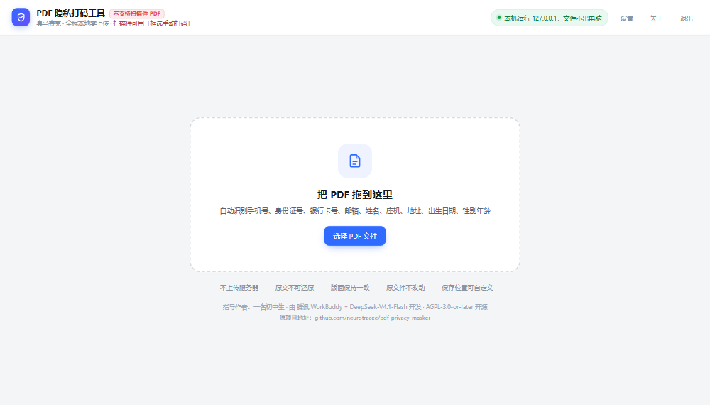
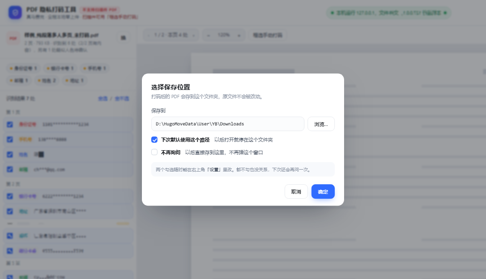
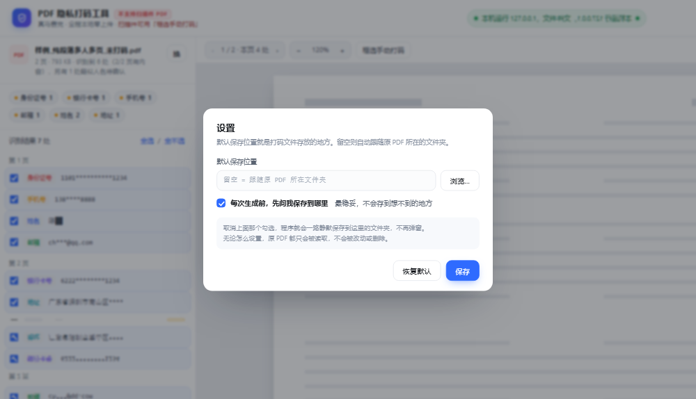

# PDF 隐私打码工具

本地离线运行的 PDF 隐私信息自动打码工具。把 PDF 拖进去，自动认出手机号、身份证号、银行卡号、邮箱、姓名、座机、地址、出生日期、性别年龄，用**不可还原的马赛克**盖掉，同时把底层的文字层一并抹除，另存为一个新文件。

自动认不出来的部分——扫描件、图片里的字、程序保守放过的内容——可以用鼠标在页面上**框选手动打码**，一样是像素级不可还原。

全程在你自己的电脑上跑，不联网、不上传，原文件不动。打码后的文件存到哪个文件夹由你决定，不硬塞进某个固定位置。


> 左侧是原始文档，右侧是打码后的结果。姓氏保留，名字与所有号码被马赛克覆盖；会议日期、金额、车牌、快递单号等普通信息原样保留。


---

## 这个项目是谁做的

- **指导作者：一名初中生。** 需求、识别规则的设计、验收测试全部由本人完成。（以下指导作者的身份“初中生”因时间变化为准，再比如以下的作者署名等部分，就具体以实际为准，24年上初中）
- **开发：腾讯 WorkBuddy × DeepSeek-V4.1-Flash。** 在指导作者的指令与反复验收下实现代码。
- **维护状态：低频维护。** 作者还在上学，不会持续跟进，可能隔几个月才会看一次 Issue、修一次明显的 bug。不保证响应速度，也不保证修——有 bug 你自己 fork 改最快。代码全部公开，欢迎任何人 fork 自行改进，不必询问。
- **开源协议：GNU AGPL-3.0-or-later。** 详见 [LICENSE](LICENSE)，另附 [ADDITIONAL-TERMS.md](ADDITIONAL-TERMS.md)。

## 关于署名（二次开发或商用前请先看这一段）

本项目**允许商用，也允许二次开发**，不需要付钱、不需要申请、不需要等作者批准
（作者已经说了不维护，等也等不到）。

但下面**三条是硬要求**，属于 [ADDITIONAL-TERMS.md](ADDITIONAL-TERMS.md) 中
依据 AGPL-3.0 第 7 条 (b) 项声明的附加条款，删掉任何一条都不合规：

### ① 保留作者署名

继续注明这两句，原文保留，不要替换成别人的名字：

```
指导作者：一名初中生
由 腾讯 WorkBuddy × DeepSeek-V4.1-Flash 开发
```

依据 AGPL-3.0 第 5 条（保留版权声明）；第 7 条 (b) 项明确允许版权方要求保留作者署名。

### ② 在程序里标注原项目地址

```
https://github.com/neurotracee/pdf-privacy-masker
```

**必须让使用者看得见**——「关于」窗口、首页页脚、帮助菜单、`--about` 输出，
任选一处即可。只写在 `LICENSE` 文件或几百行开外的源码注释里**不算数**，
因为使用者正常操作时看不到。

本项目的做法（可以直接照搬）：

| 位置 | 内容 |
| --- | --- |
| 首页页脚 | `原项目地址：https://github.com/neurotracee/pdf-privacy-masker`（点一下可复制） |
| 「关于」窗口 | `原项目地址` 一行，蓝色虚线可点 |
| 命令行 | `python pdfmask.py --about` 会打印署名与地址 |

### ③ 改过的版本必须说明改过

只要你不是拿原版原样分发，就在程序里显著注明：

> 本程序基于 https://github.com/neurotracee/pdf-privacy-masker 修改，非原作者发布。

这一条是为了不让人误以为改动后的版本出自原作者——尤其是你的版本有 bug、
有隐私风险、或者开始收费的时候。

### 除此之外，AGPL-3.0 本身还要求

- **一并开放源代码**：分发 exe 时提供可构建出该 exe 的完整源码（第 4–6 条）。
- **网络服务也要给源码**：把修改版做成网站让别人用，必须向这些使用者提供源码获取方式（第 13 条）。
- **不要加更严的限制**：不能改成「禁止商用」「禁止修改」，那与 AGPL-3.0 冲突，写了也不生效。
- **换个名字**：程序名「PDF 隐私打码工具」与图标不在授权范围内（第 7 条 (e) 项），
  fork 请改名换图标，避免别人误认。

需要闭源商用？那必须**同时**取得本项目作者的豁免（作者不维护，大概率不会回应，请不要指望）
**和** PyMuPDF 版权方 Artifex 的商业许可（见 [NOTICE.md](NOTICE.md)）。两条缺一不可。

---

## 界面



点「生成打码 PDF」时先问你要存到哪个文件夹，两个勾选决定以后还问不问：



也能随时在右上角「设置」里用勾选的方式改回来，不用记命令、不用改配置：



## 能识别什么

| 类型      | 说明                            | 打码后  |
| ------- | ----------------------------- | ---- |
| 手机号     | 支持 `138****`、`+86 138` 等写法    | 整段覆盖 |
| 身份证号    | 18 位与 15 位，含校验位与国家/地区码校验      | 整段覆盖 |
| 银行卡号    | 16–19 位，做过 Luhn 校验，避免把普通编号当卡号 | 整段覆盖 |
| 邮箱      | 常见邮箱格式                        | 整段覆盖 |
| 座机号     | `区号-号码`、`区号 号码`               | 整段覆盖 |
| 地址      | 省市区 + 街道门牌，含「XX路XX号XX室」       | 整段覆盖 |
| 出生日期    | 只有带「出生 / 生日 / 生于」语义的日期才打码     | 整段覆盖 |
| 性别 / 年龄 | `性别：女`、`，女，`、`今年 30 岁`等写法     | 覆盖   |
| 姓名      | 保留姓氏，只遮名字：`陈嘉豪` → `陈██`       | 姓氏保留 |

**普通日期（会议、合同、签署）、金额、车牌、快递单号、工号、型号等不会被误打。** 号码类都做了校验，干扰信息会原样保留。

## 自动之外，还能手动作

| 功能        | 说明                                                       |
| --------- | -------------------------------------------------------- |
| 框选手动打码    | 点工具栏「框选手动打码」，在页面上按住鼠标拉一个框，松手即成。适合扫描件、图片里的字、程序保守放过的地方 |
| 逐条确认      | 每条识别结果都有勾选框，不想打的取消勾选即可；点一条会跳到对应页面并高亮                      |
| 自定义保存位置   | 点「生成」时先弹窗问你存到哪个文件夹，可勾「下次默认此路径」「不再询问」                     |
| 设置里随时改    | 右上角「设置」用勾选的方式改：默认保存位置、是否每次都问。不用改配置文件，也没有命令行参数            |
| 原文件零改动    | 只读取原 PDF，另存为新文件；同名自动加序号，不覆盖                                    |

## 怎么用

### 方式一：直接用打包好的 exe（推荐）

1. 到 [Releases](../../releases) 下载 `PDF隐私打码工具.exe`。
2. 双击运行。**不需要安装 Python，也不需要联网。**
3. 第一次启动会慢 1–2 秒（单文件程序要先自解压到临时目录），属正常现象。
4. 如果 Windows 弹「已保护你的电脑」，点「更多信息 → 仍要运行」——程序没有购买数字签名证书，不影响功能。

界面会自己打开在浏览器里，地址是 `127.0.0.1` 的一个随机端口。关闭程序点右上角「退出」。

### 打码后的文件存在哪

第一次点「生成打码 PDF」，程序会弹一个窗问你存到哪个文件夹，选好点「确定」。窗口里有两个勾选：

- **下次默认使用这个路径**：以后打开就停在这个文件夹
- **不再询问**：以后直接存到这里，不再弹这个窗口

这两项随时能在右上角「设置」里用勾选的方式改回来。什么都不设置时，拖入的文件存到系统「下载」文件夹，双击打开的 PDF 存到原文件旁边。

选择界面用的是 Windows 原生文件夹选择框，路径也可以直接粘贴。指定的文件夹不存在时程序会自动创建。原 PDF 始终只读，不会被改动或覆盖。

### 方式二：从源码运行

```bash
pip install -r requirements.txt
python pdfmask.py
```

需要 Python 3.10 以上。

### 方式三：命令行批量处理

```bash
python pdfmask.py --cli 输入.pdf 输出.pdf
```

会打印一份 JSON，列出每处识别结果所在的页与坐标。

## 自己打包成 exe

```bash
pip install -r requirements.txt
pyinstaller pdfmask.spec --noconfirm --clean
```

产物在 `dist/PDF隐私打码工具.exe`，约 34 MB，单文件、免安装。  
`version_info.txt` 里是 exe 的文件属性（版权、产品名），可以按需修改。

## 已知限制

- **不支持扫描件 PDF。** 扫描件是整页图片、没有文字层，自动识别对它无能为力——这一点在界面左上角用红字常驻提示。这类文件请用「框选手动打码」手动拉框，效果一样不可还原。若是几页扫描件混在普通 PDF 里，程序会单独提示是哪几页。
- **加密 PDF 需要先解除密码。**
- **中文数字写的号码**（如「一三八零零」）不识别。
- **以「镇、苑、道、路、村、庄」结尾的姓名**会跳过，因为与地名无法区分，宁可放过。
- **被换行拆成两半的姓名**（姓在行尾、名在行首）可能漏掉。
- **拿不准的姓名**会列为橙色「疑似」条目，默认不打勾，需要你手动点一下。这样不会误打正文里的普通名词。

## 依赖与许可

| 依赖                                                 | 版本     | 许可                          |
| -------------------------------------------------- | ------ | --------------------------- |
| [PyMuPDF](https://pymupdf.readthedocs.io/) / MuPDF | 1.28.x | **AGPL-3.0** 或 Artifex 商业许可 |
| [Pillow](https://python-pillow.org/)               | 13.x   | HPND（类似 MIT）                |
| [PyInstaller](https://pyinstaller.org/)            | 6.x    | GPL-2.0-or-later，含打包例外条款    |

本项目选择 AGPL-3.0，正是因为核心 PDF 处理库 PyMuPDF 采用 AGPL-3.0 双授权：**分发打包后的程序，就必须以 AGPL-3.0 开源整个应用**。详见 [NOTICE.md](NOTICE.md)。

## 隐私说明

- 程序只监听 `127.0.0.1`，不对外暴露端口。
- 处理全程在本机内存与临时目录完成，退出时清理临时文件。
- 输出的 PDF 会清空元数据，不写入工具名、不写时间戳。
- 唯一会写文件的地方：你指定的输出路径。
- 程序会在 `%APPDATA%\PDF隐私打码工具\settings.json` 里存一个偏好文件，内容只有「默认保存路径」和两个开关，不含任何文档内容、不含任何个人信息。删掉它即恢复默认。

## 许可

GNU Affero General Public License v3.0 or later，见 [LICENSE](LICENSE)。
另附依据该协议第 7 条 (b) 项制定的附加条款，见 [ADDITIONAL-TERMS.md](ADDITIONAL-TERMS.md)
——核心是一句话：**二次开发或商用，必须在程序里留着作者署名和原项目地址**。

```
Copyright (C) 2026 一名初中生 (a junior high school student)

This program is free software: you can redistribute it and/or modify
it under the terms of the GNU Affero General Public License as published
by the Free Software Foundation, either version 3 of the License, or
(at your option) any later version.
```
