<a id="top-zh"></a>

<p align="center">
  <b>简体中文</b> · <a href="#pdf-privacy-masker">English</a>
</p>

<p align="center">
  <picture>
    <source media="(prefers-color-scheme: dark)" srcset="docs/img/shot/hero-zh-dark.webp">
    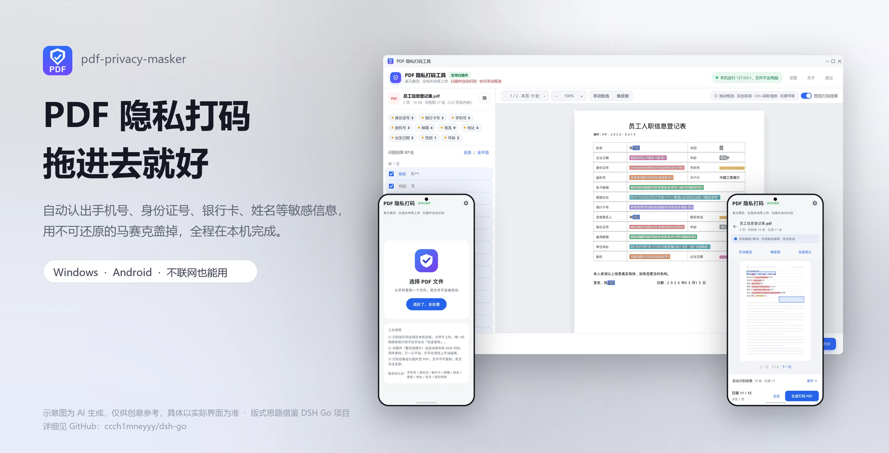
  </picture>
</p>

<p align="center">
  本地离线运行的 PDF 隐私打码工具。把 PDF 拖进去，自动认出手机号、身份证号、银行卡、姓名等敏感信息，用不可还原的马赛克盖掉；三端用同一套识别规则，全程不联网、不上传。
</p>

<p align="center">
  <a href="https://github.com/neurotracee/pdf-privacy-masker/blob/main/LICENSE"></a>
  <a href="https://github.com/neurotracee/pdf-privacy-masker/releases/latest"></a>
  <a href="https://github.com/neurotracee/pdf-privacy-masker/releases"></a>
  <a href="https://github.com/neurotracee/pdf-privacy-masker/blob/main/requirements.txt"></a>
  <a href="https://github.com/neurotracee/pdf-privacy-masker/releases"></a>
  <a href="https://gitee.com/bio234/pdf-privacy-masker/releases/latest"></a>
  <a href="https://github.com/neurotracee/pdf-privacy-masker/actions/workflows/ci.yml"></a>
</p>

<br>

> **本项目此前已在 GitHub 发布，后于 2026 年 11 月 7 日首次同步至国内开源平台 Gitee（https://gitee.com/bio234/pdf-privacy-masker）**
>
> 注：GitHub 和 Gitee 这两个仓库都由同一名开发者维护，GitHub 建得更早。写这句是为了避免有人误以为其中一个是抄来的副本。

---

本地离线运行的 PDF 隐私信息自动打码工具，不联网也能用，不用云端大模型。把 PDF 拖进去，自动认出手机号、身份证号、银行卡号、邮箱、姓名、座机、地址、出生日期、性别年龄，用**不可还原的马赛克**盖掉，同时把底层的文字层一并抹除，另存为一个新文件。

自动认不出来的部分可以**框选手动打码**，一样是像素级不可还原。

**扫描件、拍照件、整页图片的 PDF 也能自动识别**（v1.4.6 起）：没有文字层的页面会先用本机运行的 PP-OCRv4 模型做一遍文字检测与识别，再走完全相同的打码规则。模型随程序分发，**运行时依旧不联网、不上传**。

全程在你自己的电脑上跑，不上传任何内容，原文件不动。打码后的文件存到哪个文件夹由你决定，不硬塞进某个固定位置。

目前有 **Windows 版**（单文件 exe）、**安卓版**（arm64 apk）和 **Linux 版**（x86_64 AppImage），三端用同一套识别规则：Windows 与 Linux 是同一份代码，安卓端按同一套规则原生重写，并有跨端一致性测试守着两边不许跑偏。**版本号各自独立**。

---

<h3 align="center">拖进去，自动标出每一处</h3>

<p align="center">打开 PDF 就地分析：左边逐条列出识别到的敏感信息，右边预览里已经盖好马赛克，不想涂的取消勾选就行。</p>

<p align="center">
  <picture>
    <source media="(prefers-color-scheme: dark)" srcset="docs/img/shot/win-work-zh-dark.webp">
    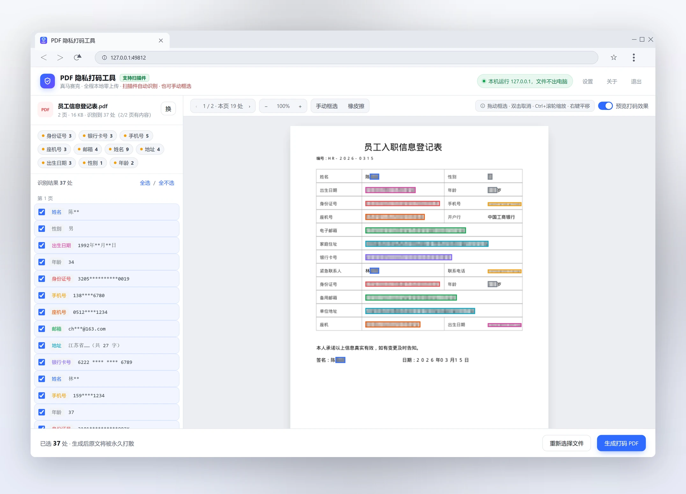
  </picture>
</p>

<br>

<h3 align="center">安卓端，功能没缩水</h3>

<p align="center">首页选文件、工作区手动框选与橡皮擦、设置里切换语言与主题；识别规则与电脑端逐条对齐——同一份测试文档在两端跑，452 条识别结果全部一致。</p>

<p align="center">
  <picture>
    <source media="(prefers-color-scheme: dark)" srcset="docs/img/shot/phone-feature-zh-dark.webp">
    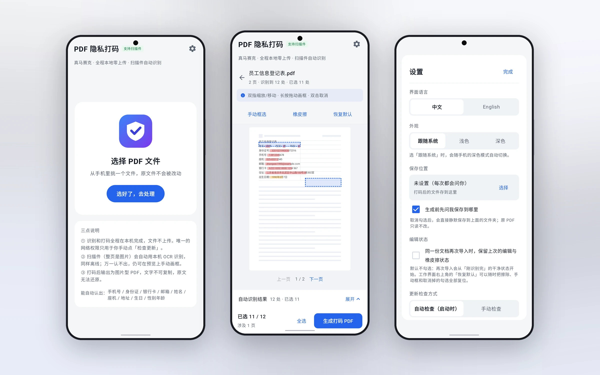
  </picture>
</p>

<br>

<h3 align="center">设置是勾选框，不是配置文件</h3>

<p align="center">保存位置、更新检查方式、界面语言都在同一个面板里，勾完立即生效，不用记命令、不用改 JSON。</p>

<p align="center">
  <picture>
    <source media="(prefers-color-scheme: dark)" srcset="docs/img/shot/win-settings-zh-dark.webp">
    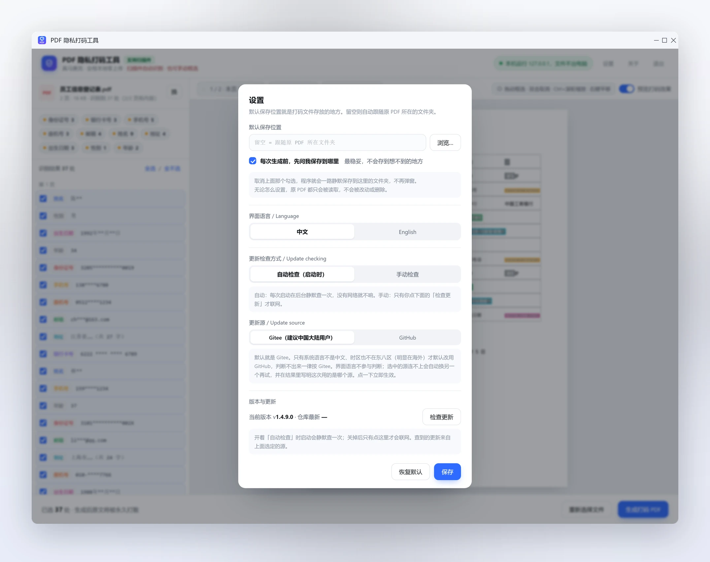
  </picture>
</p>

<br>

<h3 align="center">中文，也说 English</h3>

<p align="center">全部界面支持英文，设置里一键切换，立即生效不用重启，下次打开还是你选的那个。</p>

<p align="center">
  <picture>
    <source media="(prefers-color-scheme: dark)" srcset="docs/img/shot/lang-zh-dark.webp">
    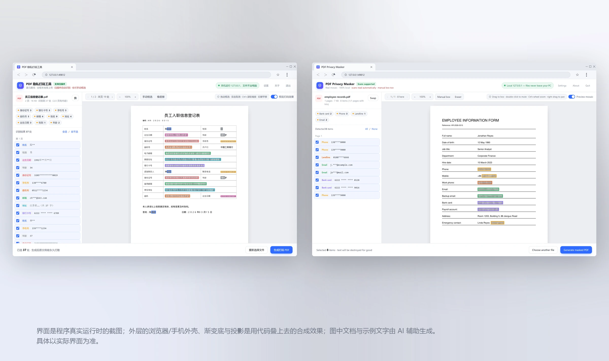
  </picture>
</p>

<br>

<p align="center">
  <sub>截图取自程序真实渲染，非示意图。安卓端的放大镜、扫描件识别、应用内更新实拍图见 <a href="docs/02-使用说明-安卓.md">使用说明 · 安卓</a>。</sub>
</p>

---

<h3 align="center">处理效果，打码前后</h3>

<p align="center">同一条竖线从左推到右，推过的地方就是打完码的样子；下面那张静态对比图可以放大看细节。</p>

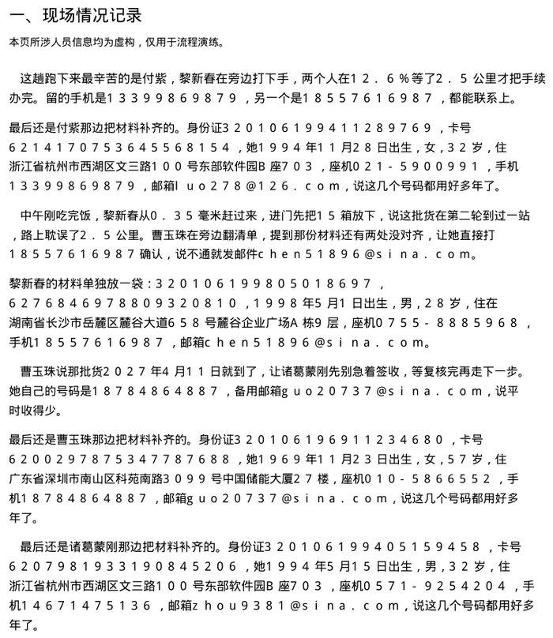

> 这段动图不是画的界面，是把同一份文档打码前后的两页真实结果叠在一起，竖线推过去的地方就是打码后的样子。姓氏保留，名字与所有号码被马赛克盖住；会议日期、金额、车牌、快递单号等普通信息原样保留。

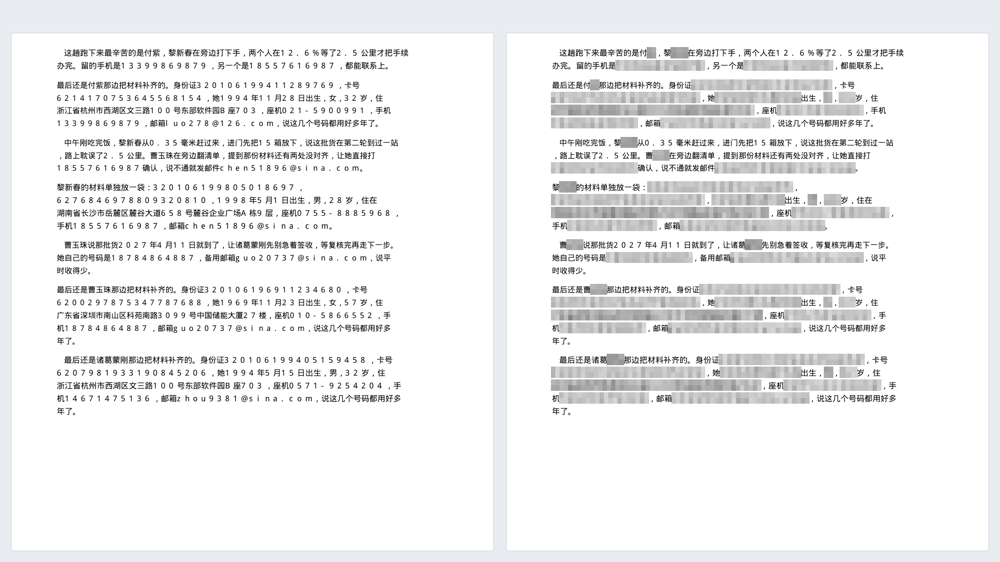

> 左侧是原始文档，右侧是打码后的结果。原图 2100×1182，网页里会被缩小显示——**[点这里打开原图放大看细节](docs/img/comparison.png)**（Gitee / GitHub 页面里也可以直接点上面的图放大）。

---

## 这个项目是谁做的

- **指导作者：项目创作时为初中生。** 需求、识别规则的设计、验收测试全部由本人完成。
- **开发：腾讯 WorkBuddy × DeepSeek-V4.1-Flash。** 在指导作者的指令与反复验收下实现代码。说明：常用、惯用、主要是 DeepSeek-V4.1-Flash——大多数场景和功能维护升级都由它作核心骨架；偶尔也会用其他模型，如 GLM 5.3 Flash、Hy4 Flash。
- **开源协议：GNU AGPL-3.0-or-later。** 详见 [LICENSE](LICENSE)，另附 [ADDITIONAL-TERMS.md](ADDITIONAL-TERMS.md)。
- **维护方式**：个人业余时间维护，代码全部公开，欢迎任何人 fork 自行改进，不必询问。具体节奏与反馈渠道见文末「[维护节奏与反馈](#维护节奏与反馈)」。

## 能识别什么

| 类型      | 说明                            | 打码后  |
| ------- | ----------------------------- | ---- |
| 手机号     | 支持 `138****`、`+86 138` 等写法    | 整段覆盖 |
| 身份证号    | 18 位与 15 位，含校验位与国家/地区码校验      | 整段覆盖 |
| 银行卡号    | 16–19 位，做过 Luhn 校验，避免把普通编号当卡号 | 整段覆盖 |
| 邮箱      | 常见邮箱格式                        | 整段覆盖 |
| 座机号     | `区号-号码`、`区号 号码`               | 整段覆盖 |
| 地址      | 省市区 + 街道门牌，含「XX路XX号XX室」       | 整段覆盖 |
| 出生日期    | 只有带「出生 / 生日 / 生于」语义的日期才打码     | 整段覆盖 |
| 性别 / 年龄 | `性别：女`、`，女，`、`今年 30 岁`等写法     | 覆盖   |
| 姓名      | 保留姓氏，只遮名字：`陈嘉豪` → `陈██`       | 姓氏保留 |

**处理过程看得见、随时能停。** 打开文件后，窗口底部会出现一块进度面板：上面是**当前页**的进度、下面是**整个文件**的进度（第 3 / 12 页 + 百分比），旁边是**暂停 / 停止**两颗按钮，暂停后第一颗变成**继续**。暂停在页与页之间生效，停下不会留下半页的坏状态；停止会直接把这次处理中止，原文件始终不动。

**扫描件 / 拍照件 / 整页图片的 PDF 也支持。** 没有文字层的页面会先用本机 OCR 认出文字与每个字的坐标，再套用上面同一套规则——不是另做一套降级逻辑。识别受拍摄清晰度、倾斜、光照影响，重要文件建议核对一遍结果。

**普通日期（会议、合同、签署）、金额、车牌、快递单号、工号、型号等不会被误打。** 号码类都做了校验，干扰信息会原样保留。

## 自动之外，还能手动作

| 功能        | 说明                                                       |
| --------- | -------------------------------------------------------- |
| 框选手动打码    | 点工具栏「框选手动打码」，在页面上按住鼠标拉一个框，松手即成。适合 OCR 没认出的扫描件、文字层 PDF 里嵌的图片、程序保守放过的地方。安卓端用手指拖，手指右上方会自动浮出 **2.8 倍放大镜**，你正在拉的虚线框也一起放大显示 |
| 双击取消打码    | 在页面上**双击任意一个方框**（自动认的红框、手画的蓝虚线框都算），这一处打码立刻取消、框变灰；再双击恢复。顶部有一条提示条写明这个操作 |
| 逐条确认      | 每条识别结果都有勾选框，不想打的取消勾选即可；点一条会跳到对应页面并高亮                      |
| 自定义保存位置   | 点「生成」时先弹窗问你存到哪个文件夹，可勾「下次默认此路径」「不再询问」                     |
| 设置里随时改    | 右上角「设置」用勾选的方式改：默认保存位置、是否每次都问。不用改配置文件，也没有命令行参数            |
| 原文件零改动    | 只读取原 PDF，另存为新文件；同名自动加序号，不覆盖                                    |

## 怎么用

### 安装包下载与版本保留规则（先看这一段）

| 情况 | Gitee（国内，推荐） | GitHub |
| --- | --- | --- |
| **最新版**（Windows + 安卓 + Linux） | [releases/latest](https://gitee.com/bio234/pdf-privacy-masker/releases/latest) 附件区：`PDFPrivacyMasker-<版本号>.exe`、`.apk`、`-x86_64.AppImage`、`SHA256SUMS.txt` **都在** | 同一版本，附件齐全 |
| **上一版**（三端） | 同样保留三端安装包，从 [releases](https://gitee.com/bio234/pdf-privacy-masker/releases) 进入对应 tag | 同一版本，附件齐全 |
| **更早的版本** | 只留更新说明，**没有安装包**——只能到 GitHub 查看和下载 | [全部历史版本](https://github.com/neurotracee/pdf-privacy-masker/releases)；指定版本：`https://github.com/neurotracee/pdf-privacy-masker/releases/tag/v<版本号>` |

> **为什么要这样分**：Gitee 仓库的 Release 附件总额度只有 **1 GB（按所有历史版本累计）**，装不下十几个版本的三端安装包。所以 Gitee **只保留最新版和上一版的三端安装包**（exe + apk + AppImage，**额度没满就一起传，不做平台取舍**），更早版本的附件才统一清理——清理时**每一版的更新说明一个字都不动**，只是安装包去 GitHub 取。**最新版三端都没有被挪到 GitHub**，exe、apk 和 AppImage 一样都在 Gitee 附件区。
>
> - 最新版：https://gitee.com/bio234/pdf-privacy-masker/releases/latest
> - 全部历史版本（GitHub）：https://github.com/neurotracee/pdf-privacy-masker/releases
> - 指定旧版本：https://github.com/neurotracee/pdf-privacy-masker/releases/tag/v`<版本号>`（把 `<版本号>` 换成具体版本，例如 `v1.4.2`）

### 方式一：直接用打包好的 exe（Windows，推荐）

1. 到发布页下载 `PDFPrivacyMasker-<版本号>.exe`（文件名里的版本号就是当前最新版）：[Gitee 发布页](https://gitee.com/bio234/pdf-privacy-masker/releases/latest) · [GitHub 发布页](https://github.com/neurotracee/pdf-privacy-masker/releases/latest)。**两个平台的安装包都在 Gitee 最新版附件区**，GitHub 是同一份文件，就近选一个下即可。
2. 双击运行。**不需要安装 Python，也不需要联网。**
3. 第一次启动会慢 1–2 秒（单文件程序要先自解压到临时目录），属正常现象。
4. 如果 Windows 弹「已保护你的电脑」，点「更多信息 → 仍要运行」——程序没有购买数字签名证书，不影响功能。

界面会自己打开在浏览器里，地址是 `127.0.0.1` 的一个随机端口。关闭程序点右上角「退出」。

> 安装包文件名带版本号，文档里不再写死某个具体版本 —— 永远去发布页拿最新的那一份，就不会下到旧包。

### 方式一之二：安装 apk（安卓）

1. 到发布页下载 `PDFPrivacyMasker-<版本号>-arm64.apk`（Android 8.0 及以上，arm64 机型）：[Gitee 发布页](https://gitee.com/bio234/pdf-privacy-masker/releases/latest) · [GitHub 发布页](https://github.com/neurotracee/pdf-privacy-masker/releases/latest)。最新版和上一版的 apk 都留在 Gitee。
2. 点开安装；系统提示「未知来源」时，允许当前文件管理器安装即可。
3. 打开后在首页点一下选 PDF，确认勾选，点「生成打码 PDF」再选保存目录。

> **装的时候也可能看到「信息将被第三方收集」这类提示。** 这句话同样来自手机系统的安装器，是所有非应用商店安装包都会显示的模板文案，不是本程序弹的；本程序没有任何第三方 SDK，不上传任何内容（详见本文开头第 ② 点）。

> **装的时候弹「开发者身份未验证」是正常的，不是包坏了。** 2026 年 11 月起，OPPO / vivo / 小米 / 荣耀对侧载安装的 apk 增加了一道开发者实名校验（ADV），本项目从 Gitee / GitHub 直接分发、没有在国内应用商店上架，所以会被标成「未验证」。处理办法：**勾选「已知悉应用风险」→ 点「仍然安装」**（部分机型还要再输一次锁屏密码），功能一点不受影响。国内这套目前只提醒、不拦截，也不需要像海外 Google 那套等 24 小时；每次装新版本都会再提示一次，属正常现象。若按钮一直是灰的，先确认勾选框已勾上，再检查「设置 → 应用 → 特殊应用权限 → 安装未知应用」里，打开 apk 的那个浏览器或文件管理是否被允许。

权限两个，都只服务于更新：`INTERNET` 用来读公开的版本号、下载安装包；`REQUEST_INSTALL_PACKAGES`（「安装应用」）只把安装包交给系统安装器，系统还会再问你一次。没有存储权限，选文件走系统文件选择器，打码全程本地完成。

### 方式一之三：Linux（AppImage，免安装）

1. 下载 `PDFPrivacyMasker-<版本号>-x86_64.AppImage`（约 88 MB）：[Gitee 发布页](https://gitee.com/bio234/pdf-privacy-masker/releases/latest) · [GitHub 发布页](https://github.com/neurotracee/pdf-privacy-masker/releases/latest)。**最新版和上一版的 AppImage 两边都有**，就近选一个下。
2. 给它执行权限再运行，或者直接在文件管理器里双击：

   ```bash
   chmod +x PDFPrivacyMasker-<版本号>-x86_64.AppImage
   ./PDFPrivacyMasker-<版本号>-x86_64.AppImage
   ```

3. 程序会在 `127.0.0.1` 起一个本地服务并打开默认浏览器，用完后关掉页面或按 `Ctrl+C` 即可。
4. 选保存文件夹时，装了 `zenity` 或 `kdialog` 会弹系统对话框；两个都没有就在页面上直接输入路径，一样能用。
5. 首次启动会慢一点（AppImage 要先把自身解包到临时目录），之后会快。基线是 Ubuntu 22.04（glibc 2.35），更新的发行版都没问题；更老的（如 Ubuntu 20.04）可能跑不起来。

> 不想用 AppImage 也可以直接从源码跑：`python3 -m pip install -r requirements.txt && python3 pdfmask.py`。

权限两个，都只服务于更新：`INTERNET` 用来读公开的版本号、下载安装包；`REQUEST_INSTALL_PACKAGES`（「安装应用」）只把安装包交给系统安装器，系统还会再问你一次。没有存储权限，选文件走系统文件选择器，打码全程本地完成。

### 打码后的文件存在哪

第一次点「生成打码 PDF」，程序会弹一个窗问你存到哪个文件夹，选好点「确定」。窗口里有两个勾选：

- **下次默认使用这个路径**：以后打开就停在这个文件夹
- **不再询问**：以后直接存到这里，不再弹这个窗口

这两项随时能在右上角「设置」里用勾选的方式改回来。什么都不设置时，拖入的文件存到系统「下载」文件夹，双击打开的 PDF 存到原文件旁边。

选择界面用的是 Windows 原生文件夹选择框，路径也可以直接粘贴。指定的文件夹不存在时程序会自动创建。原 PDF 始终只读，不会被改动或覆盖。

### 设置面板里的几个开关

- **检查更新**：打开时静默查一次，有新版本才提示；设置里也可以改成只手动查。断网就跳过，不影响打码。安卓端在应用内下载安装包并交给系统安装器。更新内容的详细说明都写在发布页：[Gitee](https://gitee.com/bio234/pdf-privacy-masker/releases) · [GitHub](https://github.com/neurotracee/pdf-privacy-masker/releases)。
- **界面语言**：中英文一键切换，立即生效不用重启，选择存在 `settings.json` 里，下次打开还是这个语言。
- **按返回 / 左右滑手势（v1.4.5 起，安卓）**：工作区里还开着文件时，返回键和全面屏手势会先问一句——**继续编辑** / **保存后离开** / **直接离开**。直接离开是回主页，不是关应用；在主页再按返回才是退出。

### 方式二：从源码运行

```bash
pip install -r requirements.txt
python pdfmask.py
```

需要 Python 3.11 以上。

### 方式三：命令行批量处理

```bash
python pdfmask.py --cli 输入.pdf 输出.pdf
```

会打印一份 JSON，列出每处识别结果所在的页与坐标。

---

## 关于署名（二次开发或商用前请先看这一段）

本项目**允许商用，也允许二次开发**，不需要付钱、不需要申请、不需要等作者批准
（作者大约一两个月查看一次项目，回复可能很慢）。

但下面**三条是硬要求**，属于 [ADDITIONAL-TERMS.md](ADDITIONAL-TERMS.md) 中
依据 AGPL-3.0 第 7 条 (b) 项声明的附加条款，删掉任何一条都不合规：

### ① 保留作者署名

继续注明这两句，原文保留，不要替换成别人的名字：

```
指导作者：项目创作时为初中生
由 腾讯 WorkBuddy × DeepSeek-V4.1-Flash 开发

说明：常用、惯用、主要是 DeepSeek-V4.1-Flash——大多数场景和功能维护升级都由它作核心骨架；偶尔也会用其他模型，如 GLM 5.3 Flash、Hy4 Flash。

Note: DeepSeek-V4.1-Flash is the model we usually and mainly rely on - the core backbone for most scenarios and maintenance; other models such as GLM 5.3 Flash and Hy4 Flash are used occasionally.
```

依据 AGPL-3.0 第 5 条（保留版权声明）；第 7 条 (b) 项明确允许版权方要求保留作者署名。

### ② 在程序里标注原项目地址

```
https://github.com/neurotracee/pdf-privacy-masker
https://gitee.com/bio234/pdf-privacy-masker      # mirror / 镜像（国内访问更快）
```

**必须让使用者看得见**——「关于」窗口、首页页脚、帮助菜单、`--about` 输出，
任选一处即可。只写在 `LICENSE` 文件或几百行开外的源码注释里**不算数**，
因为使用者正常操作时看不到。

本项目的做法（可以直接照搬）：

| 位置 | 内容 |
| --- | --- |
| 首页页脚 | `原项目地址：https://github.com/neurotracee/pdf-privacy-masker` + `Gitee: gitee.com/bio234/pdf-privacy-masker`（两行都可点，点了复制） |
| 「关于」窗口 | `原项目地址` 与 `镜像地址（Gitee）` 两行，蓝色虚线可点 |
| 命令行 | `python pdfmask.py --about` 会打印署名与地址 |

### ③ 改过的版本必须说明改过

只要你不是拿原版原样分发，就在程序里显著注明：

> 本程序基于 https://github.com/neurotracee/pdf-privacy-masker
> （镜像：https://gitee.com/bio234/pdf-privacy-masker）修改，非原作者发布。

这一条是为了不让人误以为改动后的版本出自原作者——尤其是你的版本有 bug、
有隐私风险、或者开始收费的时候。

### 除此之外，AGPL-3.0 本身还要求

- **一并开放源代码**：分发 exe（或 apk）时提供可构建出该产物的完整源码（第 4–6 条）。
- **网络服务也要给源码**：把修改版做成网站让别人用，必须向这些使用者提供源码获取方式（第 13 条）。
- **不要加更严的限制**：不能改成「禁止商用」「禁止修改」，那与 AGPL-3.0 冲突，写了也不生效。
- **换个名字**：程序名「PDF 隐私打码工具」与图标不在授权范围内（第 7 条 (e) 项），
  fork 请改名换图标，避免别人误认。

需要闭源商用？那必须**同时**取得本项目作者的豁免（回复可能需要等几周，请不要指望快速回应）
**和** PyMuPDF 版权方 Artifex 的商业许可（见 [NOTICE.md](NOTICE.md)）。两条缺一不可。

## 赞赏

如果这个项目帮你省了时间，可以请我喝杯奶茶 🧋


> **点 Star 比打赏更有用。**不想花钱完全没问题：到仓库点一颗 Star 就是最好的支持，别人搜得到，我才更有动力维护。两端「关于」窗口里都有「去点 Star」按钮（v1.4.2 新增）。
>
> 国内用户也可以扫码请我喝杯奶茶——完全自愿，不打赏一样免费、功能不缺。
>
> 想把二维码存下来：Windows 端点「保存赞赏码」，安卓端长按二维码或点「保存赞赏码」。这是 v1.4.1 补上的（更早的版本写了「长按图片可保存」，其实没生效）。

---

## 自己打包

Windows exe：

```bash
pip install -r requirements.txt
pip install pyinstaller
pyinstaller pdfmask.spec --noconfirm --clean
```

产物在 `dist/PDF隐私打码工具.exe`，约 73 MB，单文件、免安装（其中约 30 MB 是本地 OCR 的模型与推理库）。
`version_info.txt` 里是 exe 的文件属性（版权、产品名），可以按需修改。

安卓 apk：JDK 17 + Android SDK 34 + Gradle 8.7，用 Android Studio 打开 `android/` 目录即可；发布附件按 `PDFPrivacyMasker-<版本>-arm64.apk` 命名。完整步骤见 [docs/05-构建与发布.md](docs/05-构建与发布.md)。

## 已知限制

- **扫描件 PDF 的识别质量取决于扫描/拍摄条件。** 文字层 PDF 的坐标是精确的；扫描件靠 OCR 反推，模糊、严重倾斜、光线不均或字太小都可能认错或漏认。程序会在界面上标出哪几页用了 OCR，重要文件请核对结果，漏掉的地方用「框选手动打码」补——**自动识别为空不等于这页没有隐私信息**。
- **加密 PDF 需要先解除密码。**
- **中文数字写的号码**（如「一三八零零」）不识别。
- **以「镇、苑、道、路、村、庄」结尾的姓名**会跳过，因为与地名无法区分，宁可放过。
- **被换行拆成两半的姓名**（姓在行尾、名在行首）可能漏掉。
- **拿不准的姓名**会列为橙色「疑似」条目，默认不打勾，需要你手动点一下。这样不会误打正文里的普通名词。
- **安卓端输出的是整页图片。** 打码时每页重绘为 JPEG 再组装成新 PDF，所以打码后的文件**不能搜索、不能复制文字**，体积通常也比原先大；Windows 版保留矢量版面，只抹掉命中处的文字层。这是为了「彻底抹除文字层」有意做的取舍（v1.4.4 起写进说明）。
- **注释是整块处理的。** Windows 端会删掉含敏感内容的整条注释，安卓端会把该注释的矩形整块盖成马赛克；若一条注释里既有敏感内容又有要保留的说明，整条都会没，需要的话请另写一条干净的注释。

## 装之前要知道的三件事

> **① 「开发者身份未验证」——正常提示，不阻止安装。**
> 2026 年 11 月起，OPPO / vivo / 小米 / 荣耀对侧载 apk 加了开发者实名校验（ADV，四家互认）。作者是未成年人，缺其中最关键的本人实名银行卡，这条路走不通，所以提示会一直存在。处理只有两步：勾选「已知悉应用风险」→「立即安装」（个别机型再输一次锁屏密码），功能不受影响；每次更新会再提示一次。

> **② 「信息将被第三方收集」是手机系统的话，不是本程序的。**
> 所有非应用商店来源的安装包都会显示这句模板文案，与包是谁做的无关。本程序里没有任何第三方 SDK——不统计、不埋点、不广告、不上报崩溃、不登录账号，代码全部公开可查。

> **③ 唯一的联网只用于检查更新。**
> 启动时静默读一次公开发布的版本号，设置里可以改成只手动查；下载的也只是你选择更新的安装包，不传文件、不传文档内容。断网就静默跳过，打码完全不依赖网络。

## 依赖与许可

| 依赖                                                 | 版本     | 许可                          |
| -------------------------------------------------- | ------ | --------------------------- |
| [PyMuPDF](https://pymupdf.readthedocs.io/) / MuPDF | 1.28.x | **AGPL-3.0** 或 Artifex 商业许可 |
| [Pillow](https://python-pillow.org/)               | 13.x   | HPND（类似 MIT）                |
| [PyInstaller](https://pyinstaller.org/)            | 6.x    | GPL-2.0-or-later，含打包例外条款    |
| [ONNX Runtime](https://onnxruntime.ai/)（仅本地 OCR 用） | 1.31.x | MIT                        |
| [NumPy](https://numpy.org/)（仅本地 OCR 用）         | 2.5.x（Python 3.11 上为 2.4.x） | BSD-3-Clause                |
| PP-OCRv4 检测 / 识别模型（仅本地 OCR 用）              | mobile | Apache-2.0                  |
| [PDFBox-Android](https://github.com/TomRoush/PdfBox-Android)（仅安卓端） | 2.0.27.0 | Apache-2.0 |
| [ONNX Runtime Android](https://onnxruntime.ai/)（仅安卓端 OCR 用） | 1.20.0 | MIT                     |

本项目选择 AGPL-3.0，正是因为核心 PDF 处理库 PyMuPDF 采用 AGPL-3.0 双授权：**分发打包后的程序，就必须以 AGPL-3.0 开源整个应用**。详见 [NOTICE.md](NOTICE.md)。

## 隐私说明

- 程序只监听 `127.0.0.1`，不对外暴露端口。
- **没有任何第三方 SDK**：不统计、不埋点、不投放广告、不做崩溃上报、不需要登录账号。
- **联网只发生在检查更新时**：向 Gitee 或 GitHub 读一次公开发布的版本号（下载安装包时才有文件传输），不上传任何文件或个人信息。默认启动时查一次，也可改成只手动查。
- 处理全程在本机内存与临时目录完成，退出时清理临时文件。
- 输出的 PDF 会清空元数据，不写入工具名、不写时间戳。
- 文档方面，唯一会写文件的地方：你指定的输出路径。
- 扫描件识别用的 OCR 模型（PP-OCRv4，约 15 MB）随程序一起分发，推理在本机 CPU 上完成，**不联网、不调用任何在线服务**。模型来源与许可见 [assets/ocr/README.md](assets/ocr/README.md)。
- 程序会在 `%APPDATA%\PDF隐私打码工具\settings.json` 里存一个偏好文件，内容只有「默认保存路径」「两个保存选项」「界面语言」「是否自动检查更新」「更新源」这五项，不含任何文档内容、不含任何个人信息。删掉它即恢复默认。
- 安卓端有两个权限，都只在更新流程里用到：`INTERNET`（读版本号、下载安装包）和 `REQUEST_INSTALL_PACKAGES`（把安装包交给系统安装器）。不做任何统计埋点，不上传文件。

## 许可

GNU Affero General Public License v3.0 or later，见 [LICENSE](LICENSE)。
另附依据该协议第 7 条 (b) 项制定的附加条款，见 [ADDITIONAL-TERMS.md](ADDITIONAL-TERMS.md)
——核心是一句话：**二次开发或商用，必须在程序里留着作者署名和原项目地址**。

```
Copyright (C) 2026 项目创作时为初中生

This program is free software: you can redistribute it and/or modify
it under the terms of the GNU Affero General Public License as published
by the Free Software Foundation, either version 3 of the License, or
(at your option) any later version.
```

## 文档

| 想看什么 | 去哪 |
| --- | --- |
| 这一版更新了什么、修了什么 | [CHANGELOG.md](CHANGELOG.md) |
| 文档地图：哪个文件在哪、怎么找 | [DOCS.md](DOCS.md) |
| Windows / 安卓 完整操作说明 | [docs/01](docs/01-使用说明-Windows.md) · [docs/02](docs/02-使用说明-安卓.md) |
| 识别规则与已知限制 | [docs/03](docs/03-识别规则与已知限制.md) |
| 常见问题 | [docs/04](docs/04-常见问题.md) |
| 打包、测试、发版 | [docs/05](docs/05-构建与发布.md) |
| 怎么发 Release（网页一步步点） | [docs/06](docs/06-发布Release操作指南.md) |
| 想参与改进、提缺陷、加规则 | [CONTRIBUTING.md](CONTRIBUTING.md) |

安卓端没有单独的 README：两端的能力、许可、署名共用一套说法，写两份必然一头改了一头忘。

## 维护节奏与反馈

这个项目由个人在业余时间维护，取舍很直白：**识别准不准、文件会不会坏、隐私有没有漏**这类问题优先处理；界面润色、锦上添花的功能可以慢慢来。代码全部公开，任何人不经询问就可以 fork 自行改进，不必等作者回复。

- **报缺陷**：到 Issues 按模板填，写清版本号、系统、怎么复现。两端 Issues 都开着：[Gitee Issues](https://gitee.com/bio234/pdf-privacy-masker/issues) · [GitHub Issues](https://github.com/neurotracee/pdf-privacy-masker/issues/new/choose)。
- **提改进 / 提代码**：先看 [CONTRIBUTING.md](CONTRIBUTING.md)，里面有目录结构、怎么跑自检、以及提交时会被要求做什么。
- **回复可能不快**：看到了会处理，没回不代表没看见，也不代表被否掉。

---
---

<a id="pdf-privacy-masker"></a>

<p align="center">
  <a href="#top-zh">简体中文</a> · <b>English</b>
</p>

<p align="center">
  <picture>
    <source media="(prefers-color-scheme: dark)" srcset="docs/img/shot/hero-en-dark.webp">
    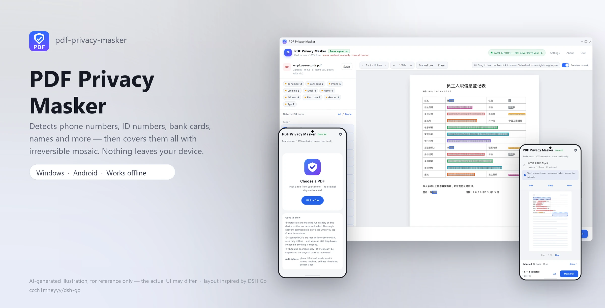
  </picture>
</p>

<p align="center">
  A fully offline PDF redaction tool. Drop a PDF in and it detects phone numbers, ID numbers, bank cards, names and more, covering them with irreversible mosaic. All three platforms apply the same detection rules — nothing is uploaded, ever.
</p>

<p align="center">
  <a href="https://github.com/neurotracee/pdf-privacy-masker/blob/main/LICENSE"></a>
  <a href="https://github.com/neurotracee/pdf-privacy-masker/releases/latest"></a>
  <a href="https://github.com/neurotracee/pdf-privacy-masker/releases"></a>
  <a href="https://github.com/neurotracee/pdf-privacy-masker/blob/main/requirements.txt"></a>
  <a href="https://github.com/neurotracee/pdf-privacy-masker/releases"></a>
  <a href="https://gitee.com/bio234/pdf-privacy-masker/releases/latest"></a>
  <a href="https://github.com/neurotracee/pdf-privacy-masker/actions/workflows/ci.yml"></a>
</p>

<br>

> **This project was originally published on GitHub, and was first mirrored to Gitee (https://gitee.com/bio234/pdf-privacy-masker), the domestic open-source platform, on 7 November 2026.**
>
> Note: this GitHub repository and the Gitee repository above are owned by the same developer. The GitHub repository was created earlier — stating this here so nobody mistakes one for a copy of the other.

---

Offline PDF privacy redaction tool — works with no network and no cloud LLM. Drag a PDF in, it automatically detects phone numbers, ID card numbers, bank card numbers, emails, names, addresses, dates of birth and gender/age, then covers them with **irreversible pixel mosaic** while stripping the underlying text layer, and saves as a new file.

Parts it can't auto-detect can be manually boxed and redacted, also pixel-level irreversible.

**Scanned, photographed and image-only PDFs are supported too** (since v1.4.6): pages without a text layer are first run through PP-OCRv4 on your own machine to recover the text and each character's position, then the exact same redaction rules apply. The models ship with the app — **still no network, nothing uploaded.**

Runs entirely on your own machine. No network, no upload, original file untouched. You choose where the redacted file is saved.

Available for **Windows** (single-file exe), **Android** (arm64 apk) and **Linux** (x86_64 AppImage). All three apply the same detection rules: Windows and Linux run the same code, while Android is a native rewrite of those rules, kept in step by a cross-platform parity test. **Each platform still has its own version number.**

---

<h3 align="center">Drop it in, every match is marked</h3>

<p align="center">The PDF is analyzed in place: detected items are listed one by one on the left, the preview on the right already shows the mosaic, and anything you'd rather keep is one checkbox away.</p>

<p align="center">
  <picture>
    <source media="(prefers-color-scheme: dark)" srcset="docs/img/shot/win-work-en-dark.webp">
    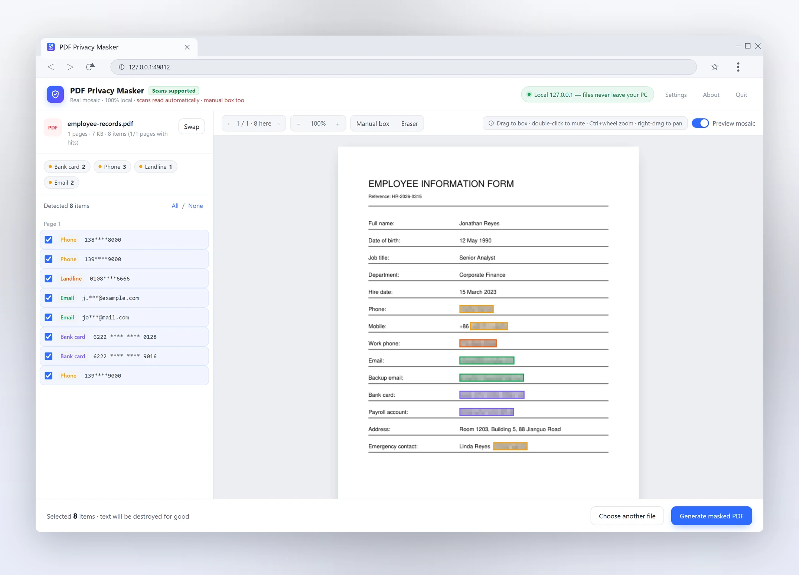
  </picture>
</p>

<br>

<h3 align="center">On Android, nothing is cut down</h3>

<p align="center">Pick a file on the home screen, draw boxes or erase them in the work screen, switch language and theme in Settings — the detection rules line up with the desktop build: the same test document, run on both sides, yields the same 452 results.</p>

<p align="center">
  <picture>
    <source media="(prefers-color-scheme: dark)" srcset="docs/img/shot/phone-feature-en-dark.webp">
    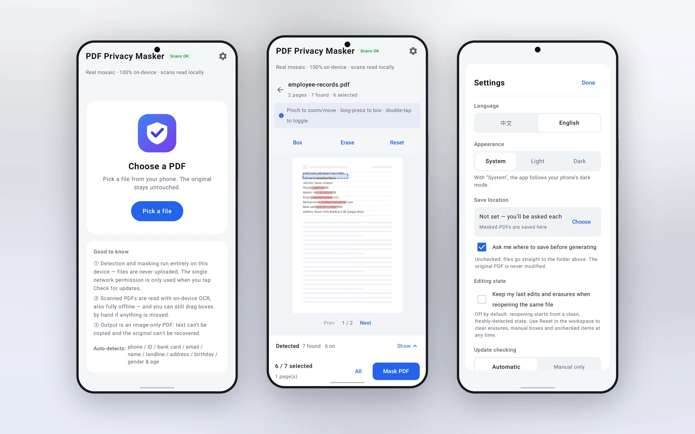
  </picture>
</p>

<br>

<h3 align="center">Settings are checkboxes, not config files</h3>

<p align="center">Save folder, update checking and UI language all live in one panel. Tick it and it takes effect — no commands, no JSON editing.</p>

<p align="center">
  <picture>
    <source media="(prefers-color-scheme: dark)" srcset="docs/img/shot/win-settings-en-dark.webp">
    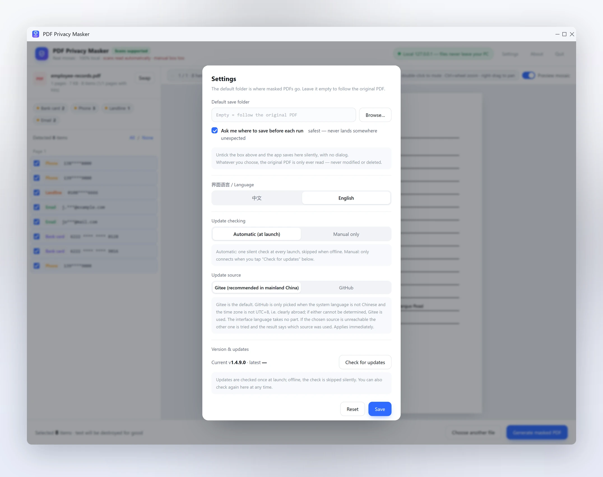
  </picture>
</p>

<br>

<h3 align="center">Chinese, and English too</h3>

<p align="center">The entire interface has an English version, switched from Settings, applied instantly, remembered next time.</p>

<p align="center">
  <picture>
    <source media="(prefers-color-scheme: dark)" srcset="docs/img/shot/lang-en-dark.webp">
    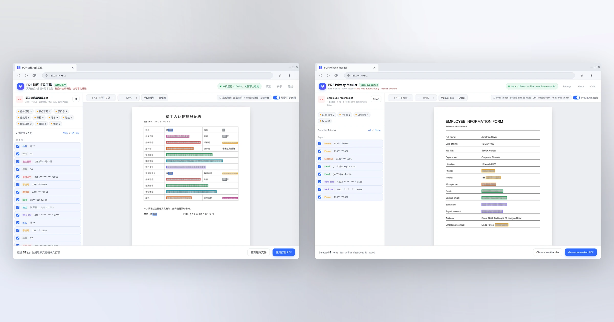
  </picture>
</p>

<br>

<p align="center">
  <sub>Captured from the real UI, not mock drawings. More Android shots (loupe, scanned-PDF recognition, in-app update) are in <a href="docs/02-使用说明-安卓.md">the Android guide</a>.</sub>
</p>

---

<h3 align="center">The result: before and after</h3>

<p align="center">The same divider sweeping left to right — wherever it has passed, you are looking at the redacted page. The static comparison below is the one to zoom into.</p>

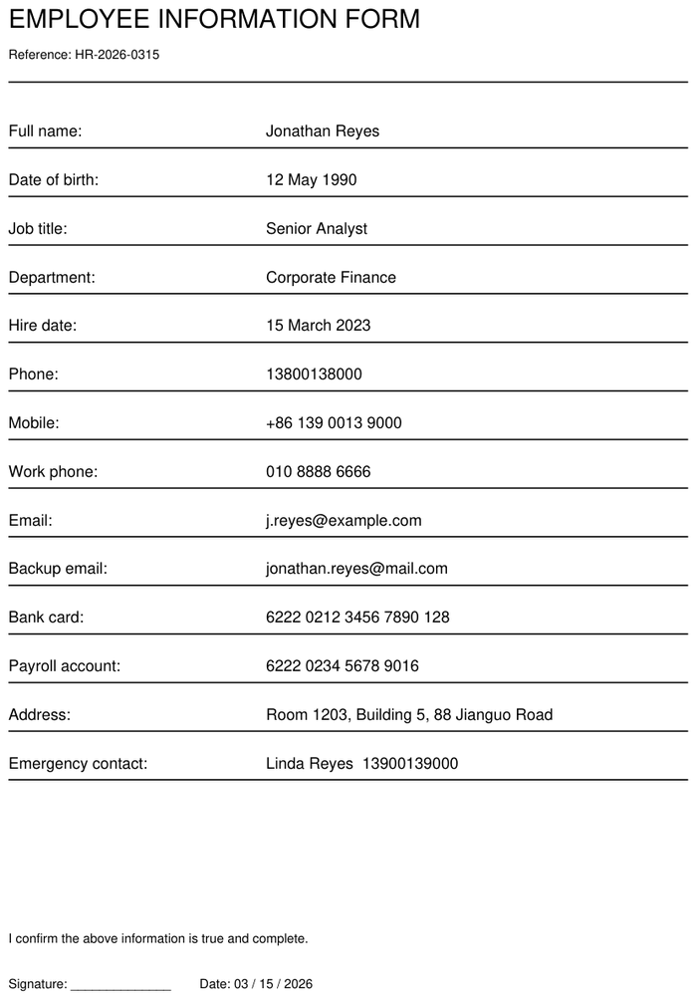

> This is not a mock-up: it is the same English form, before and after, stacked on top of each other. Where the divider has passed, you are looking at the redacted page. Phone numbers, emails and bank cards are covered by mosaic; ordinary info such as dates, job titles and addresses is preserved.

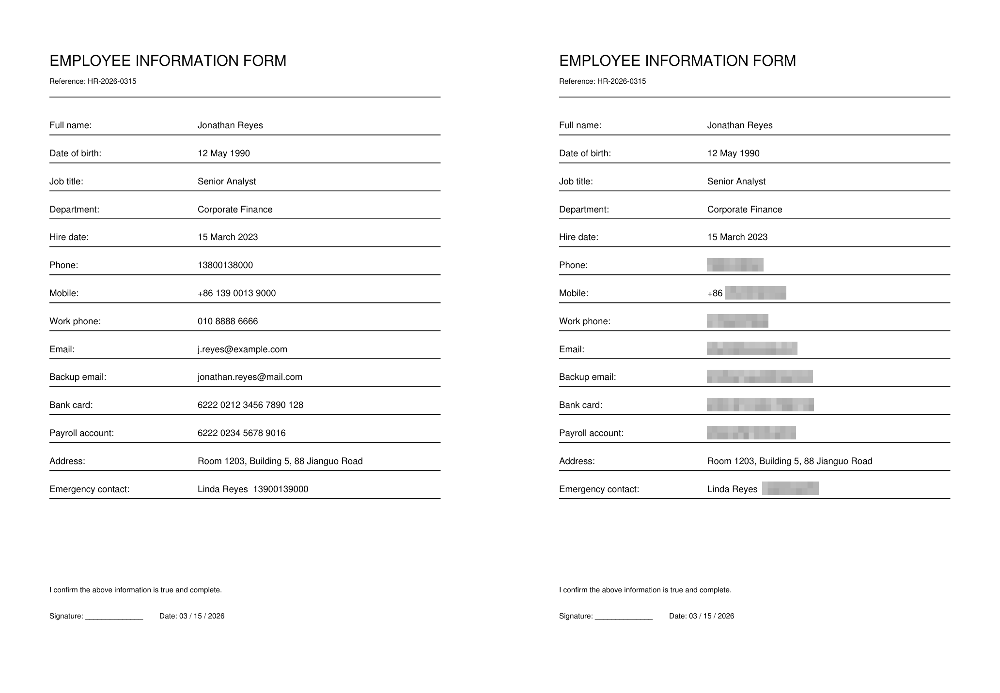

> Left is the original form, right is the redacted result. Full size is 2064x1432; pages shrink it to fit — **[open the full-size image](docs/img/comparison-en.png)** to zoom into details (on Gitee/GitHub you can also click the image above). Phone numbers, emails and bank cards are masked; dates, job titles, addresses and other ordinary info stay readable.

---

## Who made this

- **Lead author: was a junior high school student when this project was created.** Requirements, detection rule design, and acceptance testing were all completed by the author.
- **Development: Tencent WorkBuddy × DeepSeek-V4.1-Flash.** Code was written under the author's direction and repeated acceptance reviews. Note: DeepSeek-V4.1-Flash is the model we usually and mainly rely on - the core backbone for most scenarios and maintenance; other models such as GLM 5.3 Flash and Hy4 Flash are used occasionally.
- **License: GNU AGPL-3.0-or-later.** See [LICENSE](LICENSE), and [ADDITIONAL-TERMS.md](ADDITIONAL-TERMS.md) for extra terms.
- **Maintained** in spare time by one person. The code is fully open — fork and improve it whenever you like, no need to ask. See [Maintenance & feedback](#maintenance--feedback) at the end for details.

## What it can detect

| Type | Description | Redaction |
| --- | --- | --- |
| Phone numbers | Supports `138****`, `+86 138` formats | Full coverage |
| ID card numbers | 18-digit and 15-digit, with checksum and country/region code validation | Full coverage |
| Bank card numbers | 16–19 digits, Luhn check to avoid redacting ordinary numbers | Full coverage |
| Emails | Common email formats | Full coverage |
| Landline numbers | `area-code-number`, `area-code number` | Full coverage |
| Addresses | Province/city/district + street, including "XX Road XX No. XX Room" | Full coverage |
| Birth dates | Only dates with "born / birthday / born on" context | Full coverage |
| Gender / age | `Gender: female`, `, female,`, `30 years old` patterns | Covered |
| Names | Keep surname, redact given name: `陈嘉豪` → `陈██` | Surname kept |

**Ordinary dates (meetings, contracts, signing), amounts, license plates, tracking numbers, employee IDs, model numbers are NOT redacted.** Number types are validated, so noise info is preserved.

## Beyond auto-detection, manual tools

| Feature | Description |
| --- | --- |
| Manual box redaction | Click "Box redaction" in the toolbar, drag a box on the page, release to finish. For scans the OCR could not read, images embedded in a text-layer PDF, or conservative misses. On Android you drag with a finger and a **2.8× loupe** follows your fingertip, magnifying the dashed box you are drawing too |
| Double-click to mute | Double-click (double-tap on Android) any box — auto-detected or hand-drawn — to cancel that redaction; the box turns grey. Double-click again to restore. A hint bar at the top says so |
| Per-item confirmation | Each detection result has a checkbox; uncheck what you don't want redacted. Click an item to jump to the page and highlight it |
| Custom save location | Click "Generate" and it pops up a folder picker first; optionally check "default to this path" and "don't ask again" |
| Change anytime in Settings | Top-right "Settings" panel with checkboxes: default save path, whether to ask each time. No config file, no CLI arguments |
| Zero changes to original | Only reads the original PDF, saves as a new file; auto-numbers to avoid overwriting |

## How to use

### Where to download, and what is kept where (read this first)

| Case | Gitee (China, recommended) | GitHub |
| --- | --- | --- |
| **Latest release** (Windows + Android + Linux) | [releases/latest](https://gitee.com/bio234/pdf-privacy-masker/releases/latest) — `PDFPrivacyMasker-<version>.exe`, `.apk`, `-x86_64.AppImage` and `SHA256SUMS.txt` are **all there** | Same release, all assets |
| **Previous release** (all three) | All three installers are kept too; open [releases](https://gitee.com/bio234/pdf-privacy-masker/releases) and pick its tag | Same release, all assets |
| **Older releases** | Release notes only, **no installers** — you have to check GitHub for them | [All releases](https://github.com/neurotracee/pdf-privacy-masker/releases); a specific one: `https://github.com/neurotracee/pdf-privacy-masker/releases/tag/v<version>` |

> **Why**: Gitee allows only **1 GB of release attachments per repository** (across all versions), which cannot hold a dozen installers across three platforms. So Gitee keeps installers for **the latest and the previous release only** — exe, apk and AppImage together, **as long as the quota allows, with no platform left behind**; only older attachments are removed in one batch, and **their release notes are left untouched**. Older versions are therefore unavoidable GitHub-only — sorry about that.
> **No platform of the latest release is GitHub-only**: the exe, the apk and the AppImage all sit in the Gitee assets area.
>
> - Latest: https://gitee.com/bio234/pdf-privacy-masker/releases/latest
> - All history (GitHub): https://github.com/neurotracee/pdf-privacy-masker/releases
> - Specific older version: https://github.com/neurotracee/pdf-privacy-masker/releases/tag/v`<version>`

### Option 1: Use the packaged exe (recommended, Windows)

1. Download `PDFPrivacyMasker-<version>.exe` from a release page — the version in the file name is whatever is current: [Gitee releases](https://gitee.com/bio234/pdf-privacy-masker/releases/latest) · [GitHub releases](https://github.com/neurotracee/pdf-privacy-masker/releases/latest). Both repos publish the same build; use whichever is faster for you.
2. Double-click to run. **No Python install needed, no network needed.**
3. First launch takes 1–2 seconds (single-file app self-extracts to temp dir), that's normal.
4. If Windows shows "Windows protected your PC", click "More info → Run anyway" — the app has no code signing certificate, but it works fine.

The UI opens automatically in your browser at a random `127.0.0.1` port. Close the app by clicking "Exit" in the top-right corner.

> Installer names carry the version now, and these docs no longer pin one — always take the newest from the releases page and you cannot end up with a stale build.

### Option 1b: Install the apk (Android)

1. Download `PDFPrivacyMasker-<version>-arm64.apk` (Android 8.0+, arm64 devices) from a release page: [Gitee releases](https://gitee.com/bio234/pdf-privacy-masker/releases/latest) · [GitHub releases](https://github.com/neurotracee/pdf-privacy-masker/releases/latest). Both repos publish the same build.
2. Tap to install; allow "unknown sources" for your file manager if the system asks.
3. Tap a PDF on the home screen, confirm the detections, then tap "Mask PDF" and pick a folder.

> **You may also see a notice that information may be collected by third parties.** That sentence again comes from the phone's package installer and is boilerplate for any apk outside an app store — this app does not show it. The app bundles no third-party SDKs and uploads nothing (see note ② at the top).

> **An "unverified developer" warning during install is expected — your download is not broken.** Since November 2026, OPPO / vivo / Xiaomi / HONOR run an Android Developer Verification (ADV) check on sideloaded apks. This project ships straight from Gitee / GitHub and is not listed on the Chinese app stores, so it is flagged as unverified. To proceed: **tick "I understand the risk" and tap "Install anyway"** (some models then ask for your screen-lock PIN). Nothing else changes. On the mainland this is a warning, not a block, and there is no 24-hour wait like Google's flow abroad; the prompt reappears on every update, which is normal. If "Install anyway" stays greyed out, make sure the risk checkbox is ticked, then check Settings → Apps → Special app access → Install unknown apps and allow the browser or file manager you opened the apk with.

Two permissions, both only for updates: `INTERNET` reads the public version number and downloads the installer; `REQUEST_INSTALL_PACKAGES` hands the installer to the system installer, which asks you once more. No storage permission — files are picked through the system file picker, and all masking happens on device.

### Option 1c: Linux (AppImage, no installation)

1. Download `PDFPrivacyMasker-<version>-x86_64.AppImage` (about 88 MB): [Gitee releases](https://gitee.com/bio234/pdf-privacy-masker/releases/latest) · [GitHub releases](https://github.com/neurotracee/pdf-privacy-masker/releases/latest). **The AppImage for the latest and the previous release is available on both**, so pick the closer one.
2. Make it executable and run it, or just double-click it in your file manager:

   ```bash
   chmod +x PDFPrivacyMasker-<version>-x86_64.AppImage
   ./PDFPrivacyMasker-<version>-x86_64.AppImage
   ```

3. It starts a local server on `127.0.0.1` and opens your default browser. Close the page or press `Ctrl+C` when you are done.
4. When choosing an output folder, a native dialog appears if `zenity` or `kdialog` is installed; otherwise type the path into the page — either works.
5. First launch is slower (the AppImage unpacks itself into a temp directory), later launches are faster. The baseline is Ubuntu 22.04 (glibc 2.35); newer distros are fine, older ones (e.g. Ubuntu 20.04) may not run.

> Prefer not to use the AppImage? Run from source: `python3 -m pip install -r requirements.txt && python3 pdfmask.py`.

### Where are the redacted files saved

First time you click "Generate Redacted PDF", it pops up a folder picker. Pick a folder and click "OK". Two checkboxes in the window:

- **Default to this path next time**: future launches stay in this folder
- **Don't ask again**: save directly here without popping up

You can change these anytime in the top-right "Settings". If nothing is set, dragged-in files go to the system "Downloads" folder, and double-clicked PDFs go next to the original file.

The picker is the native Windows folder dialog; you can also paste a path directly. If the folder doesn't exist, the app creates it. The original PDF is always read-only, never modified or overwritten.

### The switches in Settings

- **Check for updates**: one silent check at launch, offering an update only when a newer build exists; Settings can switch it to manual only. Offline, it is skipped silently and the app stays fully usable. On Android the installer is downloaded inside the app and handed to the system installer. Detailed notes for each version live on the release pages: [Gitee](https://gitee.com/bio234/pdf-privacy-masker/releases) · [GitHub](https://github.com/neurotracee/pdf-privacy-masker/releases).
- **Language** switches the whole interface between Chinese and English instantly, no restart. The choice is remembered in `settings.json`.
- **Back button / edge swipe (Android, since v1.4.5)**: while a file is open, both the back button and the full-screen gestures are caught and a small dialog offers **Keep editing** / **Save, then leave** (only once a result exists) / **Leave anyway**. Leaving returns to the app's home screen, not out of the app. Back from the home screen is what exits.

### Option 2: Run from source

```bash
pip install -r requirements.txt
python pdfmask.py
```

Requires Python 3.11+.

### Option 3: CLI batch mode

```bash
python pdfmask.py --cli input.pdf output.pdf
```

Prints a JSON listing every detection result's page and coordinates.

---

## About attribution (read this before forking or commercial use)

This project **allows commercial use and forks**, no payment, no application, no approval needed (the author checks the project roughly once every 1–2 months, so responses may be slow).

But the **three hard requirements below** are part of [ADDITIONAL-TERMS.md](ADDITIONAL-TERMS.md) declared under AGPL-3.0 Section 7(b). Removing any of them is non-compliant:

### ① Keep the author attribution

Keep these two lines verbatim, don't replace with someone else's name:

```
Lead author: was a junior high school student when this project was created
Developed by Tencent WorkBuddy × DeepSeek-V4.1-Flash

Note: DeepSeek-V4.1-Flash is the model we usually and mainly rely on - the core backbone for most scenarios and maintenance; other models such as GLM 5.3 Flash and Hy4 Flash are used occasionally.
```

This is based on AGPL-3.0 Section 5 (preserve copyright notices); Section 7(b) explicitly allows the copyright holder to require attribution.

### ② Show the original project URL in the program

```
https://github.com/neurotracee/pdf-privacy-masker
https://gitee.com/bio234/pdf-privacy-masker      # mirror / 镜像（国内访问更快）
```

**Must be visible to users** — in the About window, footer, help menu, or `--about` output, pick any one. Writing it only in `LICENSE` or a source comment hundreds of lines away **doesn't count**, because users won't see it during normal operation.

How this project does it (you can copy it directly):

| Location | Content |
| --- | --- |
| Footer | `Original project: https://github.com/neurotracee/pdf-privacy-masker` + `Gitee: gitee.com/bio234/pdf-privacy-masker` (both click to copy) |
| About window | `Original project` and `Mirror (Gitee)` lines, blue dashed clickable |
| CLI | `python pdfmask.py --about` prints attribution and URL |

### ③ State clearly if your version is modified

Unless you're distributing the original unmodified, add a prominent notice in the program:

> This program is based on https://github.com/neurotracee/pdf-privacy-masker
> (mirror: https://gitee.com/bio234/pdf-privacy-masker), modified, not released by the original author.

This prevents people from mistaking a modified version as the original author's — especially when your version has bugs, privacy risks, or starts charging.

### Beyond AGPL-3.0 itself

- **Open source alongside distribution**: when distributing the exe (or apk), provide the complete source code that builds it (Sections 4–6).
- **Network services also need source**: if you make a modified version into a website for others, you must give those users a way to get the source (Section 13).
- **Don't add stricter restrictions**: you can't change it to "no commercial use" or "no modification" — that conflicts with AGPL-3.0 and won't take effect.
- **Rename it**: the program name "PDF Privacy Masker" and icon are not covered by the license (Section 7(e)). Forks must rename and rebrand to avoid confusion.

Need closed-source commercial use? You must **both** get an exemption from the project author (response may take weeks, so don't count on it) **and** a commercial license from Artifex, the PyMuPDF copyright holder (see [NOTICE.md](NOTICE.md)). Both are required.

---

## Support

If this project saved you some time, you can buy me a bubble tea 🧋


> The caption inside that image is Chinese because it is WeChat's own donation poster, not something the app draws.

> **A star beats a tip.** If you don't feel like paying anything, starring the repo is the best support — it helps others find the project. Both apps have a **Star it** button in the About window (v1.4.2).
>
> Domestic users can also scan the QR code to buy me a milk tea — entirely optional; the app stays free and fully functional either way.
>
> Want to keep the QR? In the app, use **About → Save the tip QR** (Windows) or **long-press the QR code / tap Save the QR** (Android). Added in v1.4.1.

---

## Build your own

Windows exe:

```bash
pip install -r requirements.txt
pip install pyinstaller
pyinstaller pdfmask.spec --noconfirm --clean
```

Output is `dist/PDF隐私打码工具.exe`, about 73 MB, single-file, no install needed (roughly 30 MB of that is the local OCR models and runtime).
`version_info.txt` contains the exe's file properties (copyright, product name), adjust as needed.

Android apk: JDK 17 + Android SDK 34 + Gradle 8.7, open the `android/` directory. Name release assets `PDFPrivacyMasker-<version>-arm64.apk` — the updater reads the version from the file name. Full steps in [docs/05-构建与发布.md](docs/05-构建与发布.md).

## Known limitations

- **Detection quality on scanned PDFs depends on the scan.** Text-layer PDFs give exact coordinates; scans rely on OCR inference, so blur, heavy skew, uneven lighting or very small text can cause misses or misreads. The UI marks which pages went through OCR. Please verify the result on important documents and box anything missed by hand — **an empty detection result does not mean the page has no private data.**
- **Encrypted PDFs need password removed first.**
- **Chinese numeral numbers** (like "一三八零零") are not detected.
- **Names ending in 镇/苑/道/路/村/庄** are skipped because they're indistinguishable from place names — better to miss than to mis-redact.
- **Names split across line breaks** (surname at end of line, given name at start of next) may be missed.
- **Uncertain names** are listed as orange "suspected" items, unchecked by default, requiring you to manually check. This avoids mis-redacting ordinary nouns in the text.
- **On Android the output is full-page images.** Each page is re-rendered as JPEG and assembled into a new PDF, so the redacted file **cannot be searched and its text cannot be copied**; it is usually larger too. The Windows build keeps the vector layout and only removes the text layer at the hits. This is a deliberate trade for wiping the text layer (spelled out since v1.4.4).
- **Annotations are handled as a whole.** On Windows an annotation containing sensitive content is deleted entirely; on Android its whole rectangle is mosaicked. If one annotation holds both sensitive content and text worth keeping, all of it goes — write a separate clean note instead.

## Three things to know before installing

> **① "Unverified developer" — a normal warning, not a block.**
> Since November 2026, OPPO / vivo / Xiaomi / HONOR have added Android Developer Verification (ADV, mutually recognised) for sideloaded apks. The author is a minor and cannot obtain the key requirement — a bank card registered in their own name — so this warning will stay. Two steps: tick "I understand the risk", then tap "Install anyway" (some phones ask for the screen-lock PIN). Nothing is blocked; it reappears on every update.

> **② "Information may be collected by third parties" comes from the phone, not this app.**
> That sentence is boilerplate shown for every apk installed outside an app store, whoever built it. This app bundles no third-party SDKs — no analytics, no tracking, no ads, no crash reporting, no account. The source is public.

> **③ The only network access is the update check.**
> One silent read of the public version number at launch, or manual only if you prefer; the only file ever downloaded is the installer you choose. Nothing is uploaded. Offline it is skipped silently and redaction never depends on the network.


## Dependencies & License

| Dependency | Version | License |
| --- | --- | --- |
| [PyMuPDF](https://pymupdf.readthedocs.io/) / MuPDF | 1.28.x | **AGPL-3.0** or Artifex commercial license |
| [Pillow](https://python-pillow.org/) | 13.x | HPND (similar to MIT) |
| [PyInstaller](https://pyinstaller.org/) | 6.x | GPL-2.0-or-later with packaging exception |
| [ONNX Runtime](https://onnxruntime.ai/) (local OCR only) | 1.31.x | MIT |
| [NumPy](https://numpy.org/) (local OCR only) | 2.5.x (2.4.x on Python 3.11) | BSD-3-Clause |
| PP-OCRv4 detection / recognition models (local OCR only) | mobile | Apache-2.0 |
| [PDFBox-Android](https://github.com/TomRoush/PdfBox-Android) (Android only) | 2.0.27.0 | Apache-2.0 |
| [ONNX Runtime Android](https://onnxruntime.ai/) (Android OCR only) | 1.20.0 | MIT |

This project chooses AGPL-3.0 precisely because the core PDF library PyMuPDF is dual-licensed under AGPL-3.0: **distributing the packaged app means the whole application must be AGPL-3.0 open source.** See [NOTICE.md](NOTICE.md).

## Privacy notes

- The app only listens on `127.0.0.1`, no external ports.
- **No third-party SDKs at all**: no analytics, no tracking, no ads, no crash reporting, no account login.
- **Network use is limited to update checks**: one public version number is read from Gitee or GitHub (plus the installer itself if you choose to update); nothing is uploaded. One check at launch by default, or manual-only if you switch it in Settings; offline it is skipped silently.
- Processing happens entirely in local memory and temp files; temp files are cleaned on exit.
- Output PDF metadata is stripped — no tool name, no timestamp written.
- As for your documents, the only file written is your specified output path (plus the small preference file below).
- The app stores a preference file at `%APPDATA%\PDF隐私打码工具\settings.json` — only the default save path, the two save toggles, the UI language, whether to auto-check for updates, and the update source. No document content, no personal info. Delete it to reset.
- On Android there are two permissions, both used only in the update flow: `INTERNET` (version number and installer download) and `REQUEST_INSTALL_PACKAGES` (handing the installer to the system). No analytics, no uploads.

## License

GNU Affero General Public License v3.0 or later, see [LICENSE](LICENSE).
Extra terms under Section 7(b), see [ADDITIONAL-TERMS.md](ADDITIONAL-TERMS.md) — the core is one sentence: **fork or commercial use must keep the author attribution and original project URL in the program.**

```
Copyright (C) 2026 a junior high school student at the time of project creation

This program is free software: you can redistribute it and/or modify
it under the terms of the GNU Affero General Public License as published
by the Free Software Foundation, either version 3 of the License, or
(at your option) any later version.
```

## Docs

| What | Where |
| --- | --- |
| What changed in this version, what got fixed | [CHANGELOG.md](CHANGELOG.md) |
| Doc map — where every file is, how to find things | [DOCS.md](DOCS.md) |
| Windows / Android user guides | [docs/01](docs/01-使用说明-Windows.md) · [docs/02](docs/02-使用说明-安卓.md) |
| Detection rules & limitations | [docs/03](docs/03-识别规则与已知限制.md) |
| FAQ | [docs/04](docs/04-常见问题.md) |
| Build, test, release | [docs/05](docs/05-构建与发布.md) |
| How to publish a release (web UI, step by step) | [docs/06](docs/06-发布Release操作指南.md) |
| Contribute, report bugs, add rules | [CONTRIBUTING.md](CONTRIBUTING.md) |

The Android app has no separate README on purpose: both platforms share one set of capabilities, licence and attribution, and two copies always drift apart.

## Maintenance & feedback

This project is maintained by one person in their spare time, and the priorities are plain: **does it detect correctly, does it ever break a file, can anything private slip through** — those come first; cosmetic polish and nice-to-haves can wait. The code is fully open — fork and improve it whenever you like, no need to wait for a reply.

- **Report a bug**: use the issue templates and include the version, your OS, and the steps to reproduce. Issues are open on both hosts: [Gitee Issues](https://gitee.com/bio234/pdf-privacy-masker/issues) · [GitHub Issues](https://github.com/neurotracee/pdf-privacy-masker/issues/new/choose).
- **Suggest a change or send code**: read [CONTRIBUTING.md](CONTRIBUTING.md) first — it covers the layout, how to run the self-check, and what a patch is expected to include.
- **Replies may be slow**: if it is seen it gets handled. No reply does not mean it was ignored or rejected.

