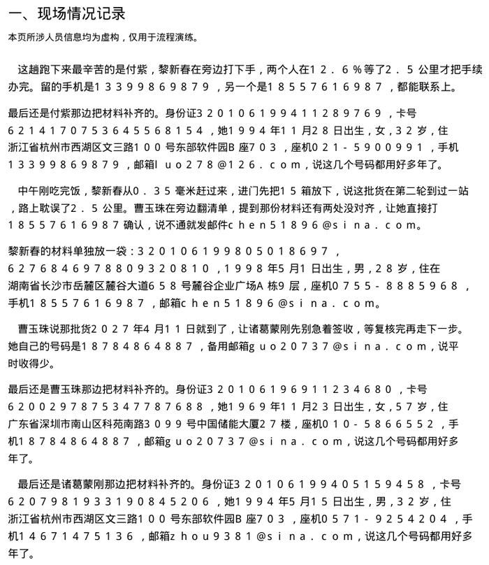

# PDF 隐私打码工具

[](https://github.com/neurotracee/pdf-privacy-masker/blob/main/LICENSE)
[](https://github.com/neurotracee/pdf-privacy-masker/releases/latest)
[](https://github.com/neurotracee/pdf-privacy-masker/releases)
[](https://github.com/neurotracee/pdf-privacy-masker/blob/main/requirements.txt)
[](https://github.com/neurotracee/pdf-privacy-masker/releases)
[](https://gitee.com/bio234/pdf-privacy-masker)
[](https://github.com/neurotracee/pdf-privacy-masker/actions/workflows/ci.yml)

**中文** | [English](#pdf-privacy-masker)

> **本项目此前已在 GitHub 发布，于 2026 年 11 月 7 日同步至国内开源平台 Gitee（https://gitee.com/bio234/pdf-privacy-masker）**
>
> 注：GitHub 和 Gitee 这两个仓库都由同一名开发者维护，GitHub 建得更早。写这句是为了避免有人误以为其中一个是抄来的副本。

本地离线、无需 AI 模型即可运行的 PDF 隐私信息自动打码工具。把 PDF 拖进去，自动认出手机号、身份证号、银行卡号、邮箱、姓名、座机、地址、出生日期、性别年龄，用**不可还原的马赛克**盖掉，同时把底层的文字层一并抹除，另存为一个新文件。

自动认不出来的部分——扫描件、图片里的字、程序保守放过的内容——可以**框选手动打码**，一样是像素级不可还原。

全程在你自己的电脑上跑，不上传任何内容，原文件不动。唯一联网的地方是「检查更新」——只读一个公开的版本号，断网时静默跳过。打码后的文件存到哪个文件夹由你决定，不硬塞进某个固定位置。

目前有 **Windows 版**（单文件 exe）和**安卓版**（arm64 apk），两端共用同一套识别内核、同一个版本号。



> 这段动图不是画的界面，是把同一份文档打码前后的两页真实结果叠在一起，竖线推过去的地方就是打码后的样子。姓氏保留，名字与所有号码被马赛克盖住；会议日期、金额、车牌、快递单号等普通信息原样保留。

静态对比图（想放大看细节用这张）：


> 左侧是原始文档，右侧是打码后的结果。

---

## 这个项目是谁做的

- **指导作者：项目创作时为初中生。** 需求、识别规则的设计、验收测试全部由本人完成。
- **开发：腾讯 WorkBuddy × DeepSeek-V4.1-Flash。** 在指导作者的指令与反复验收下实现代码。
- **开源协议：GNU AGPL-3.0-or-later。** 详见 [LICENSE](LICENSE)，另附 [ADDITIONAL-TERMS.md](ADDITIONAL-TERMS.md)。
- **维护方式**：个人业余时间维护，代码全部公开，欢迎任何人 fork 自行改进，不必询问。具体节奏与反馈渠道见文末「[维护节奏与反馈](#维护节奏与反馈)」。

## 关于署名（二次开发或商用前请先看这一段）

本项目**允许商用，也允许二次开发**，不需要付钱、不需要申请、不需要等作者批准
（作者大约一两个月查看一次项目，回复可能很慢）。

但下面**三条是硬要求**，属于 [ADDITIONAL-TERMS.md](ADDITIONAL-TERMS.md) 中
依据 AGPL-3.0 第 7 条 (b) 项声明的附加条款，删掉任何一条都不合规：

### ① 保留作者署名

继续注明这两句，原文保留，不要替换成别人的名字：

```
指导作者：项目创作时为初中生
由 腾讯 WorkBuddy × DeepSeek-V4.1-Flash 开发
```

依据 AGPL-3.0 第 5 条（保留版权声明）；第 7 条 (b) 项明确允许版权方要求保留作者署名。

### ② 在程序里标注原项目地址

```
https://github.com/neurotracee/pdf-privacy-masker
https://gitee.com/bio234/pdf-privacy-masker      # mirror / 镜像（国内访问更快）
```

**必须让使用者看得见**——「关于」窗口、首页页脚、帮助菜单、`--about` 输出，
任选一处即可。只写在 `LICENSE` 文件或几百行开外的源码注释里**不算数**，
因为使用者正常操作时看不到。

本项目的做法（可以直接照搬）：

| 位置 | 内容 |
| --- | --- |
| 首页页脚 | `原项目地址：https://github.com/neurotracee/pdf-privacy-masker` + `Gitee: gitee.com/bio234/pdf-privacy-masker`（两行都可点，点了复制） |
| 「关于」窗口 | `原项目地址` 与 `镜像地址（Gitee）` 两行，蓝色虚线可点 |
| 命令行 | `python pdfmask.py --about` 会打印署名与地址 |

### ③ 改过的版本必须说明改过

只要你不是拿原版原样分发，就在程序里显著注明：

> 本程序基于 https://github.com/neurotracee/pdf-privacy-masker
> （镜像：https://gitee.com/bio234/pdf-privacy-masker）修改，非原作者发布。

这一条是为了不让人误以为改动后的版本出自原作者——尤其是你的版本有 bug、
有隐私风险、或者开始收费的时候。

### 除此之外，AGPL-3.0 本身还要求

- **一并开放源代码**：分发 exe（或 apk）时提供可构建出该产物的完整源码（第 4–6 条）。
- **网络服务也要给源码**：把修改版做成网站让别人用，必须向这些使用者提供源码获取方式（第 13 条）。
- **不要加更严的限制**：不能改成「禁止商用」「禁止修改」，那与 AGPL-3.0 冲突，写了也不生效。
- **换个名字**：程序名「PDF 隐私打码工具」与图标不在授权范围内（第 7 条 (e) 项），
  fork 请改名换图标，避免别人误认。

需要闭源商用？那必须**同时**取得本项目作者的豁免（回复可能需要等几周，请不要指望快速回应）
**和** PyMuPDF 版权方 Artifex 的商业许可（见 [NOTICE.md](NOTICE.md)）。两条缺一不可。

---

## 界面


点「生成打码 PDF」时先问你要存到哪个文件夹，两个勾选决定以后还问不问：


也能随时在右上角「设置」里用勾选的方式改回来，不用记命令、不用改配置：


同一个面板里还有**检查更新**和**界面语言（中文 / English）**：

- **自动检查更新（v1.4.2 新增）**：打开程序就查一次，比当前版本新就提示更新，安卓端直接在本应用内下载并交给系统安装器（不走浏览器，详见下文「下载下来的文件为什么不再带 .zip」）。断网时静默跳过——不弹窗、不报错，照样能打码。万一卡住，窗口上有关闭按钮；作者在发布说明里标了**强烈建议更新**的版本提醒会更重，但同样能关掉（关之前会挽留一次）。**没有任何版本会锁住窗口。**
- **检查方式**：「自动检查（启动时）」/「手动检查」。自动每次启动在后台静默查一次，没网就跳过；手动则只有点「检查更新」才联网。
- **更新源**：「Gitee（建议中国大陆用户）」/「GitHub」，自己选。留在默认时**默认就是 Gitee**：中文系统走 Gitee，语言不是中文但在东八区（中国大陆、中国港澳台、新加坡等）也走 Gitee，只有「语言不是中文 + 时区也不在东八区」这种明确的海外环境才用 GitHub，任何一项判断不出来一律按 Gitee 兜底。**界面语言不参与判断**——把界面切成英文不代表人在海外。这个判断在启动时算一次就固定，不会出现「一进来 GitHub、关掉窗口又变 Gitee」的抖动。选中的源连不上会自动换另一个再试，并且会写明「Gitee 这次没连上，已自动改用 GitHub」，不让人猜。证书校验全程严格，下载地址只认 GitHub / Gitee 的官方发布域名，被篡改的版本号骗不到你的浏览器。比当前版本新就自动用默认浏览器打开下载页；网络被拦时会把链接摆出来、给一个复制按钮，并列出该查哪几项权限（浏览器/安全软件、系统代理、防火墙），最后还能截屏用文字识别把链接抠出来。整个过程只发一个查版本号的请求，不传文件、不传个人信息。
- **更新弹窗长什么样（v1.4.4 起）**：不管是启动时自动检查还是点「检查更新」，窗口都是三层——顶上一行 **100 字以内的摘要**（从发布页正文那句「一句话」读出来的，只说最要紧的几条），中间是把改动按 **Windows / 安卓** 分开标好的**详细条目**（就地上下翻看，不用跳出去），末尾一条「具体详见 Release 页面」给全文。摘要不是写死在程序里的：以后发版只要发布页正文带上那行「一句话」，弹窗自动跟着变。
- **下载下来的文件为什么不再带 .zip（v1.4.5 起，安卓）**：Gitee 的附件 CDN 把 `.apk` 标成 `application/zip`（同一个仓库的 `.exe` 标得是对的），浏览器按类型命名，就会把文件存成 `xxx.apk.zip`，点了装不上。现在安卓端不再把安装包交给浏览器：应用自己下载到自己的缓存目录、文件名固定 `.apk`，下完核对「头 4 字节是 PK / 大小一致 / 包名是本应用 / 版本号等于要装的那一版」，再交给系统安装器。任何一项不对都不装。「用浏览器下载」还留着，旁边写明了「末尾被加了 .zip 就把 .zip 去掉」。
- **按返回 / 左右滑手势（v1.4.5 起，安卓）**：工作区里还开着文件时，返回键和全面屏手势都会被接住，先弹一个小窗口：**继续编辑** / **保存后离开**（已打出结果时才出现）/ **直接离开**。直接离开是回主页，不是关应用——什么时候想重新选文件都行。在主页再按返回才是退出。
- **界面语言**：中英文一键切换，立即生效不用重启，选择存在 `settings.json` 里，下次打开还是这个语言。

## 能识别什么

| 类型      | 说明                            | 打码后  |
| ------- | ----------------------------- | ---- |
| 手机号     | 支持 `138****`、`+86 138` 等写法    | 整段覆盖 |
| 身份证号    | 18 位与 15 位，含校验位与国家/地区码校验      | 整段覆盖 |
| 银行卡号    | 16–19 位，做过 Luhn 校验，避免把普通编号当卡号 | 整段覆盖 |
| 邮箱      | 常见邮箱格式                        | 整段覆盖 |
| 座机号     | `区号-号码`、`区号 号码`               | 整段覆盖 |
| 地址      | 省市区 + 街道门牌，含「XX路XX号XX室」       | 整段覆盖 |
| 出生日期    | 只有带「出生 / 生日 / 生于」语义的日期才打码     | 整段覆盖 |
| 性别 / 年龄 | `性别：女`、`，女，`、`今年 30 岁`等写法     | 覆盖   |
| 姓名      | 保留姓氏，只遮名字：`陈嘉豪` → `陈██`       | 姓氏保留 |

**普通日期（会议、合同、签署）、金额、车牌、快递单号、工号、型号等不会被误打。** 号码类都做了校验，干扰信息会原样保留。

## 自动之外，还能手动作

| 功能        | 说明                                                       |
| --------- | -------------------------------------------------------- |
| 框选手动打码    | 点工具栏「框选手动打码」，在页面上按住鼠标拉一个框，松手即成。适合扫描件、图片里的字、程序保守放过的地方。安卓端用手指拖，手指右上方会自动浮出 **2.8 倍放大镜**，你正在拉的虚线框也一起放大显示 |
| 双击取消打码    | 在页面上**双击任意一个方框**（自动认的红框、手画的蓝虚线框都算），这一处打码立刻取消、框变灰；再双击恢复。顶部有一条提示条写明这个操作 |
| 逐条确认      | 每条识别结果都有勾选框，不想打的取消勾选即可；点一条会跳到对应页面并高亮                      |
| 自定义保存位置   | 点「生成」时先弹窗问你存到哪个文件夹，可勾「下次默认此路径」「不再询问」                     |
| 设置里随时改    | 右上角「设置」用勾选的方式改：默认保存位置、是否每次都问。不用改配置文件，也没有命令行参数            |
| 原文件零改动    | 只读取原 PDF，另存为新文件；同名自动加序号，不覆盖                                    |

## 怎么用

### 方式一：直接用打包好的 exe（Windows，推荐）

1. 到 **[Releases 页面](https://github.com/neurotracee/pdf-privacy-masker/releases/latest)** 下载 `PDFPrivacyMasker-<版本号>.exe`（文件名里的版本号就是当前最新版；国内网络慢可以直接去 [Gitee 发布页](https://gitee.com/bio234/pdf-privacy-masker/releases/latest)，两边是同一个包）。
2. 双击运行。**不需要安装 Python，也不需要联网。**
3. 第一次启动会慢 1–2 秒（单文件程序要先自解压到临时目录），属正常现象。
4. 如果 Windows 弹「已保护你的电脑」，点「更多信息 → 仍要运行」——程序没有购买数字签名证书，不影响功能。

界面会自己打开在浏览器里，地址是 `127.0.0.1` 的一个随机端口。关闭程序点右上角「退出」。

> 安装包文件名带版本号，文档里不再写死某个具体版本 —— 永远去发布页拿最新的那一份，就不会下到旧包。

### 方式一之二：安装 apk（安卓）

1. 到 **[Releases 页面](https://github.com/neurotracee/pdf-privacy-masker/releases/latest)** 下载 `PDFPrivacyMasker-<版本号>-arm64.apk`（Android 8.0 及以上，arm64 机型；[Gitee 发布页](https://gitee.com/bio234/pdf-privacy-masker/releases/latest) 同款）。
2. 点开安装；系统提示「未知来源」时，允许当前文件管理器安装即可。
3. 打开后在首页点一下选 PDF，确认勾选，点「生成打码 PDF」再选保存目录。

权限两个，都只服务于更新：`INTERNET` 用来读一个公开的版本号、下载安装包本身；`REQUEST_INSTALL_PACKAGES`（「安装应用」）只用来把下载好并核对过的安装包交给系统安装器——系统还会再问你一次，你不点就不会装。没有存储权限，选文件走系统文件选择器，打码全程本地完成。

### 打码后的文件存在哪

第一次点「生成打码 PDF」，程序会弹一个窗问你存到哪个文件夹，选好点「确定」。窗口里有两个勾选：

- **下次默认使用这个路径**：以后打开就停在这个文件夹
- **不再询问**：以后直接存到这里，不再弹这个窗口

这两项随时能在右上角「设置」里用勾选的方式改回来。什么都不设置时，拖入的文件存到系统「下载」文件夹，双击打开的 PDF 存到原文件旁边。

选择界面用的是 Windows 原生文件夹选择框，路径也可以直接粘贴。指定的文件夹不存在时程序会自动创建。原 PDF 始终只读，不会被改动或覆盖。

### 方式二：从源码运行

```bash
pip install -r requirements.txt
python pdfmask.py
```

需要 Python 3.11 以上。

### 方式三：命令行批量处理

```bash
python pdfmask.py --cli 输入.pdf 输出.pdf
```

会打印一份 JSON，列出每处识别结果所在的页与坐标。

## 自己打包

Windows exe：

```bash
pip install -r requirements.txt
pyinstaller pdfmask.spec --noconfirm --clean
```

产物在 `dist/PDF隐私打码工具.exe`，约 35 MB，单文件、免安装。
`version_info.txt` 里是 exe 的文件属性（版权、产品名），可以按需修改。

安卓 apk：JDK 17 + Android SDK 34 + Gradle 8.7，用 Android Studio 打开 `android/` 目录即可；发布附件按 `PDFPrivacyMasker-<版本>-arm64.apk` 命名（检查更新靠文件名读版本号）。完整步骤见 [docs/05-构建与发布.md](docs/05-构建与发布.md)。

## 已知限制

- **不支持扫描件 PDF。** 扫描件是整页图片、没有文字层，自动识别对它无能为力——这一点在界面左上角用红字常驻提示。这类文件请用「框选手动打码」手动拉框，效果一样不可还原。若是几页扫描件混在普通 PDF 里，程序会单独提示是哪几页。
- **加密 PDF 需要先解除密码。**
- **中文数字写的号码**（如「一三八零零」）不识别。
- **以「镇、苑、道、路、村、庄」结尾的姓名**会跳过，因为与地名无法区分，宁可放过。
- **被换行拆成两半的姓名**（姓在行尾、名在行首）可能漏掉。
- **拿不准的姓名**会列为橙色「疑似」条目，默认不打勾，需要你手动点一下。这样不会误打正文里的普通名词。
- **安卓端输出的是整页图片。** 打码时每页重绘为 JPEG 再组装成新 PDF，所以打码后的文件**不能搜索、不能复制文字**，体积通常也比原先大；Windows 版保留矢量版面，只抹掉命中处的文字层。这是为了「彻底抹除文字层」有意做的取舍（v1.4.4 起写进说明）。
- **注释是整块处理的。** Windows 端会删掉含敏感内容的整条注释，安卓端会把该注释的矩形整块盖成马赛克；若一条注释里既有敏感内容又有要保留的说明，整条都会没，需要的话请另写一条干净的注释。

## 依赖与许可

| 依赖                                                 | 版本     | 许可                          |
| -------------------------------------------------- | ------ | --------------------------- |
| [PyMuPDF](https://pymupdf.readthedocs.io/) / MuPDF | 1.28.x | **AGPL-3.0** 或 Artifex 商业许可 |
| [Pillow](https://python-pillow.org/)               | 13.x   | HPND（类似 MIT）                |
| [PyInstaller](https://pyinstaller.org/)            | 6.x    | GPL-2.0-or-later，含打包例外条款    |
| [PDFBox-Android](https://github.com/TomRoush/PdfBox-Android)（仅安卓端） | 2.0.27.0 | Apache-2.0 |

本项目选择 AGPL-3.0，正是因为核心 PDF 处理库 PyMuPDF 采用 AGPL-3.0 双授权：**分发打包后的程序，就必须以 AGPL-3.0 开源整个应用**。详见 [NOTICE.md](NOTICE.md)。

## 隐私说明

- 程序只监听 `127.0.0.1`，不对外暴露端口。
- 处理全程在本机内存与临时目录完成，退出时清理临时文件。
- 输出的 PDF 会清空元数据，不写入工具名、不写时间戳。
- 唯一会写文件的地方：你指定的输出路径。
- 程序会在 `%APPDATA%\PDF隐私打码工具\settings.json` 里存一个偏好文件，内容只有「默认保存路径」和两个开关，不含任何文档内容、不含任何个人信息。删掉它即恢复默认。
- 安卓端有两个权限，都只在更新流程里用到：`INTERNET`（读版本号、下载安装包）和 `REQUEST_INSTALL_PACKAGES`（把核对过的安装包交给系统安装器）。不做任何统计埋点，不上传文件。
- 留在默认设置时，每次启动会向 Gitee（中文 / 东八区环境优先，判断规则见上文）或 GitHub 读一次公开的版本号；在设置里切成「手动检查」之后，就只有你点「检查更新」时才联网。这个请求只带版本号，不带任何本地信息。

## 许可

GNU Affero General Public License v3.0 or later，见 [LICENSE](LICENSE)。
另附依据该协议第 7 条 (b) 项制定的附加条款，见 [ADDITIONAL-TERMS.md](ADDITIONAL-TERMS.md)
——核心是一句话：**二次开发或商用，必须在程序里留着作者署名和原项目地址**。

```
Copyright (C) 2026 项目创作时为初中生

This program is free software: you can redistribute it and/or modify
it under the terms of the GNU Affero General Public License as published
by the Free Software Foundation, either version 3 of the License, or
(at your option) any later version.
```

## 文档

| 想看什么 | 去哪 |
| --- | --- |
| 这一版更新了什么、修了什么 | [CHANGELOG.md](CHANGELOG.md) |
| 文档地图：哪个文件在哪、怎么找 | [DOCS.md](DOCS.md) |
| Windows / 安卓 完整操作说明 | [docs/01](docs/01-使用说明-Windows.md) · [docs/02](docs/02-使用说明-安卓.md) |
| 识别规则与已知限制 | [docs/03](docs/03-识别规则与已知限制.md) |
| 常见问题 | [docs/04](docs/04-常见问题.md) |
| 打包、测试、发版 | [docs/05](docs/05-构建与发布.md) |
| 怎么发 Release（网页一步步点） | [docs/06](docs/06-发布Release操作指南.md) |
| 想参与改进、提缺陷、加规则 | [CONTRIBUTING.md](CONTRIBUTING.md) |

安卓端没有单独的 README：两端的能力、许可、署名共用一套说法，写两份必然一头改了一头忘。

## 维护节奏与反馈

这个项目由个人在业余时间维护，取舍很直白：**识别准不准、文件会不会坏、隐私有没有漏**这类问题优先处理；界面润色、锦上添花的功能可以慢慢来。代码全部公开，任何人不经询问就可以 fork 自行改进，不必等作者回复。

- **报缺陷**：到 [Issues](https://github.com/neurotracee/pdf-privacy-masker/issues/new/choose) 按模板填，写清版本号、系统、怎么复现。两端 Issues 都开着，Gitee 那边也行（[Gitee Issues](https://gitee.com/bio234/pdf-privacy-masker/issues)）。
- **提改进 / 提代码**：先看 [CONTRIBUTING.md](CONTRIBUTING.md)，里面有目录结构、怎么跑自检、以及提交时会被要求做什么。
- **回复可能不快**：看到了会处理，没回不代表没看见，也不代表被否掉。

## 赞赏

如果这个项目帮你省了时间，可以请我喝杯奶茶 🧋


> **点 Star 比打赏更有用。**不想花钱完全没问题：到仓库点一颗 Star 就是最好的支持，别人搜得到，我才更有动力维护。两端「关于」窗口里都有「去点 Star」按钮（v1.4.2 新增）。
>
> 国内用户也可以扫码请我喝杯奶茶——完全自愿，不打赏一样免费、功能不缺。
>
> 想把二维码存下来：Windows 端点「保存赞赏码」，安卓端长按二维码或点「保存赞赏码」。这是 v1.4.1 补上的（更早的版本写了「长按图片可保存」，其实没生效）。

---
---

# PDF Privacy Masker

[中文](#pdf-隐私打码工具) | **English**

> **This project was originally published on GitHub, and was mirrored to Gitee (https://gitee.com/bio234/pdf-privacy-masker), the domestic open-source platform, on 7 November 2026.**
>
> Note: this GitHub repository and the Gitee repository above are owned by the same developer. The GitHub repository was created earlier — stating this here so nobody mistakes one for a copy of the other.

Offline PDF privacy redaction tool — no AI model required. Drag a PDF in, it automatically detects phone numbers, ID card numbers, bank card numbers, emails, names, addresses, dates of birth and gender/age, then covers them with **irreversible pixel mosaic** while stripping the underlying text layer, and saves as a new file.

Parts it can't auto-detect — scanned documents, text inside images, conservative misses — can be manually boxed and redacted, also pixel-level irreversible.

Runs entirely on your own machine. No network, no upload, original file untouched. You choose where the redacted file is saved.

Available for **Windows** (single-file exe) and **Android** (arm64 apk). Both share the same detection engine and the same version number.


> This is not a mock-up: it is the same document, before and after, stacked on top of each other. Where the divider has passed, you are looking at the redacted page. Surnames are kept; given names and every number are covered by mosaic; meeting dates, amounts, license plates and tracking numbers are preserved.

Static comparison, if you want to zoom in on details:


> Left is the original document, right is the redacted result. Surnames are kept, given names and all numbers are covered by mosaic; meeting dates, amounts, license plates, tracking numbers and other ordinary info are preserved.

---

## Who made this

- **Lead author: was a junior high school student when this project was created.** Requirements, detection rule design, and acceptance testing were all completed by the author.
- **Development: Tencent WorkBuddy × DeepSeek-V4.1-Flash.** Code was written under the author's direction and repeated acceptance reviews.
- **License: GNU AGPL-3.0-or-later.** See [LICENSE](LICENSE), and [ADDITIONAL-TERMS.md](ADDITIONAL-TERMS.md) for extra terms.
- **Maintained** in spare time by one person. The code is fully open — fork and improve it whenever you like, no need to ask. See [Maintenance & feedback](#maintenance--feedback) at the end for details.

## About attribution (read this before forking or commercial use)

This project **allows commercial use and forks**, no payment, no application, no approval needed (the author checks the project roughly once every 1–2 months, so responses may be slow).

But the **three hard requirements below** are part of [ADDITIONAL-TERMS.md](ADDITIONAL-TERMS.md) declared under AGPL-3.0 Section 7(b). Removing any of them is non-compliant:

### ① Keep the author attribution

Keep these two lines verbatim, don't replace with someone else's name:

```
Lead author: was a junior high school student when this project was created
Developed by Tencent WorkBuddy × DeepSeek-V4.1-Flash
```

This is based on AGPL-3.0 Section 5 (preserve copyright notices); Section 7(b) explicitly allows the copyright holder to require attribution.

### ② Show the original project URL in the program

```
https://github.com/neurotracee/pdf-privacy-masker
https://gitee.com/bio234/pdf-privacy-masker      # mirror / 镜像（国内访问更快）
```

**Must be visible to users** — in the About window, footer, help menu, or `--about` output, pick any one. Writing it only in `LICENSE` or a source comment hundreds of lines away **doesn't count**, because users won't see it during normal operation.

How this project does it (you can copy it directly):

| Location | Content |
| --- | --- |
| Footer | `Original project: https://github.com/neurotracee/pdf-privacy-masker` + `Gitee: gitee.com/bio234/pdf-privacy-masker` (both click to copy) |
| About window | `Original project` and `Mirror (Gitee)` lines, blue dashed clickable |
| CLI | `python pdfmask.py --about` prints attribution and URL |

### ③ State clearly if your version is modified

Unless you're distributing the original unmodified, add a prominent notice in the program:

> This program is based on https://github.com/neurotracee/pdf-privacy-masker
> (mirror: https://gitee.com/bio234/pdf-privacy-masker), modified, not released by the original author.

This prevents people from mistaking a modified version as the original author's — especially when your version has bugs, privacy risks, or starts charging.

### Beyond AGPL-3.0 itself

- **Open source alongside distribution**: when distributing the exe (or apk), provide the complete source code that builds it (Sections 4–6).
- **Network services also need source**: if you make a modified version into a website for others, you must give those users a way to get the source (Section 13).
- **Don't add stricter restrictions**: you can't change it to "no commercial use" or "no modification" — that conflicts with AGPL-3.0 and won't take effect.
- **Rename it**: the program name "PDF Privacy Masker" and icon are not covered by the license (Section 7(e)). Forks must rename and rebrand to avoid confusion.

Need closed-source commercial use? You must **both** get an exemption from the project author (response may take weeks, so don't count on it) **and** a commercial license from Artifex, the PyMuPDF copyright holder (see [NOTICE.md](NOTICE.md)). Both are required.

---

## Interface


When you click "Generate Redacted PDF", it first asks which folder to save to, with two checkboxes deciding whether to ask again:


You can also change this anytime in the Settings panel in the top-right corner — no command line, no config file editing:


The same panel also has **Check for updates** and **Language (中文 / English)**:

- **Automatic update check**: the default mode checks once at launch, compares versions, and if a newer build exists it offers the update — on Android the app downloads the installer itself and hands it to the system installer (no browser; see “Why the downloaded file no longer ends in .zip”). Offline, the check is skipped silently — no dialog, no error, and the app stays fully usable. Switch to **Manual only** in Settings if you would rather have nothing go online until you ask. A window that hangs still has a close button; a release marked *strongly suggested* by the author only raises the tone (a stronger badge and one gentle nudge before you close it) — **it can always be dismissed. No release ever locks the window.**
- **Update source** is yours to pick: **Gitee (recommended in mainland China)** or **GitHub**. Left on the default, **Gitee is the default**: a Chinese system uses Gitee; a non-Chinese system still in UTC+8 (mainland China, Hong Kong/Macao/Taiwan of China, Singapore, etc.) also uses Gitee; GitHub is only used when the language is non-Chinese **and** the time zone is not UTC+8, and if either cannot be determined, Gitee wins. **The interface language takes no part** — switching the UI to English does not mean you are abroad. The decision is computed once at launch and cached, so it cannot flip to GitHub on the first frame and back to Gitee a moment later. Whichever you pick, an unreachable source automatically falls back to the other one, and the UI says so (“Gitee could not be reached, so GitHub was used”). It never relaxes TLS verification, and only accepts download links from the official GitHub/Gitee release hosts. If there is a newer build, Android downloads it inside the app and hands it to the system installer; if the network is blocked it shows the link, a copy button, and a short checklist. The only thing it sends is a plain request for the public version number and, if you choose to update, the installer download itself.
- **What the update dialog shows (since v1.4.4)**: whether it is the automatic check at launch or the manual one, the window has three layers — a **summary of 100 characters or less** at the top (read from the “In one line” line in the release body, only the changes that matter most), then the **detailed items tagged Windows / Android** right there (scroll in place, no need to leave the app), and finally **“Full notes on the release page”**. The summary is not hard-coded: keep that line in the release notes and the dialog follows automatically.
- **Why the downloaded file no longer ends in .zip (Android, since v1.4.5)**: Gitee's attachment CDN labels `.apk` as `application/zip` (the same repository's `.exe` is labelled correctly), and browsers name the file after the type — so the installer arrived as `xxx.apk.zip` and would not install. The app no longer hands the download to the browser: it fetches the file into its own cache under a fixed `.apk` name, then checks the first four bytes are `PK`, the byte count matches, the package name is this app, and the version equals the one being installed. Anything off and nothing is installed. “Browser” is still there as a fallback, with a note that a trailing `.zip` just needs deleting.
- **Back button / edge swipe (Android, since v1.4.5)**: while a file is open, both the back button and the full-screen gestures are caught and a small dialog offers **Keep editing** / **Save, then leave** (only once a result exists) / **Leave anyway**. Leaving returns to the app's home screen, not out of the app — pick another file whenever you like. Back from the home screen is what exits.
- **Language** switches the whole interface between Chinese and English instantly, no restart. The choice is remembered in `settings.json`.

## What it can detect

| Type | Description | Redaction |
| --- | --- | --- |
| Phone numbers | Supports `138****`, `+86 138` formats | Full coverage |
| ID card numbers | 18-digit and 15-digit, with checksum and country/region code validation | Full coverage |
| Bank card numbers | 16–19 digits, Luhn check to avoid redacting ordinary numbers | Full coverage |
| Emails | Common email formats | Full coverage |
| Landline numbers | `area-code-number`, `area-code number` | Full coverage |
| Addresses | Province/city/district + street, including "XX Road XX No. XX Room" | Full coverage |
| Birth dates | Only dates with "born / birthday / born on" context | Full coverage |
| Gender / age | `Gender: female`, `, female,`, `30 years old` patterns | Covered |
| Names | Keep surname, redact given name: `陈嘉豪` → `陈██` | Surname kept |

**Ordinary dates (meetings, contracts, signing), amounts, license plates, tracking numbers, employee IDs, model numbers are NOT redacted.** Number types are validated, so noise info is preserved.

## Beyond auto-detection, manual tools

| Feature | Description |
| --- | --- |
| Manual box redaction | Click "Box redaction" in the toolbar, drag a box on the page, release to finish. For scanned documents, text inside images, or conservative misses. On Android you drag with a finger and a **2.8× loupe** follows your fingertip, magnifying the dashed box you are drawing too |
| Double-click to mute | Double-click (double-tap on Android) any box — auto-detected or hand-drawn — to cancel that redaction; the box turns grey. Double-click again to restore. A hint bar at the top says so |
| Per-item confirmation | Each detection result has a checkbox; uncheck what you don't want redacted. Click an item to jump to the page and highlight it |
| Custom save location | Click "Generate" and it pops up a folder picker first; optionally check "default to this path" and "don't ask again" |
| Change anytime in Settings | Top-right "Settings" panel with checkboxes: default save path, whether to ask each time. No config file, no CLI arguments |
| Zero changes to original | Only reads the original PDF, saves as a new file; auto-numbers to avoid overwriting |

## How to use

### Option 1: Use the packaged exe (recommended, Windows)

1. Go to the **[Releases page](https://github.com/neurotracee/pdf-privacy-masker/releases/latest)** and download `PDFPrivacyMasker-<version>.exe` — the version in the file name is whatever is current; on a slow connection in mainland China use the [Gitee release page](https://gitee.com/bio234/pdf-privacy-masker/releases/latest), it is the same build.
2. Double-click to run. **No Python install needed, no network needed.**
3. First launch takes 1–2 seconds (single-file app self-extracts to temp dir), that's normal.
4. If Windows shows "Windows protected your PC", click "More info → Run anyway" — the app has no code signing certificate, but it works fine.

The UI opens automatically in your browser at a random `127.0.0.1` port. Close the app by clicking "Exit" in the top-right corner.

> Installer names carry the version now, and these docs no longer pin one — always take the newest from the releases page and you cannot end up with a stale build.

### Option 1b: Install the apk (Android)

1. On the **[Releases page](https://github.com/neurotracee/pdf-privacy-masker/releases/latest)**, download `PDFPrivacyMasker-<version>-arm64.apk` (Android 8.0+, arm64 devices; the [Gitee release page](https://gitee.com/bio234/pdf-privacy-masker/releases/latest) has the same file).
2. Tap to install; allow "unknown sources" for your file manager if the system asks.
3. Tap a PDF on the home screen, confirm the detections, then tap "Mask PDF" and pick a folder.

Two permissions, both only for updates: `INTERNET` reads the public version number and downloads the installer; `REQUEST_INSTALL_PACKAGES` hands a verified installer to the system installer (the system asks you again — nothing installs unless you tap it). No storage permission — files are picked through the system file picker, and all masking happens on device.

### Where are the redacted files saved

First time you click "Generate Redacted PDF", it pops up a folder picker. Pick a folder and click "OK". Two checkboxes in the window:

- **Default to this path next time**: future launches stay in this folder
- **Don't ask again**: save directly here without popping up

You can change these anytime in the top-right "Settings". If nothing is set, dragged-in files go to the system "Downloads" folder, and double-clicked PDFs go next to the original file.

The picker is the native Windows folder dialog; you can also paste a path directly. If the folder doesn't exist, the app creates it. The original PDF is always read-only, never modified or overwritten.

### Option 2: Run from source

```bash
pip install -r requirements.txt
python pdfmask.py
```

Requires Python 3.11+.

### Option 3: CLI batch mode

```bash
python pdfmask.py --cli input.pdf output.pdf
```

Prints a JSON listing every detection result's page and coordinates.

## Build your own

Windows exe:

```bash
pip install -r requirements.txt
pyinstaller pdfmask.spec --noconfirm --clean
```

Output is `dist/PDF隐私打码工具.exe`, about 35 MB, single-file, no install needed.
`version_info.txt` contains the exe's file properties (copyright, product name), adjust as needed.

Android apk: JDK 17 + Android SDK 34 + Gradle 8.7, open the `android/` directory. Name release assets `PDFPrivacyMasker-<version>-arm64.apk` — the updater reads the version from the file name. Full steps in [docs/05-构建与发布.md](docs/05-构建与发布.md).

## Known limitations

- **No support for scanned PDFs.** Scanned PDFs are full-page images with no text layer, so auto-detection can't work — this is shown in red in the top-left corner. Use "Box redaction" to manually draw boxes; result is equally irreversible. If some scanned pages are mixed in a normal PDF, the app tells you which pages.
- **Encrypted PDFs need password removed first.**
- **Chinese numeral numbers** (like "一三八零零") are not detected.
- **Names ending in 镇/苑/道/路/村/庄** are skipped because they're indistinguishable from place names — better to miss than to mis-redact.
- **Names split across line breaks** (surname at end of line, given name at start of next) may be missed.
- **Uncertain names** are listed as orange "suspected" items, unchecked by default, requiring you to manually check. This avoids mis-redacting ordinary nouns in the text.
- **On Android the output is full-page images.** Each page is re-rendered as JPEG and assembled into a new PDF, so the redacted file **cannot be searched and its text cannot be copied**; it is usually larger too. The Windows build keeps the vector layout and only removes the text layer at the hits. This is a deliberate trade for wiping the text layer (spelled out since v1.4.4).
- **Annotations are handled as a whole.** On Windows an annotation containing sensitive content is deleted entirely; on Android its whole rectangle is mosaicked. If one annotation holds both sensitive content and text worth keeping, all of it goes — write a separate clean note instead.

## Dependencies & License

| Dependency | Version | License |
| --- | --- | --- |
| [PyMuPDF](https://pymupdf.readthedocs.io/) / MuPDF | 1.28.x | **AGPL-3.0** or Artifex commercial license |
| [Pillow](https://python-pillow.org/) | 13.x | HPND (similar to MIT) |
| [PyInstaller](https://pyinstaller.org/) | 6.x | GPL-2.0-or-later with packaging exception |
| [PDFBox-Android](https://github.com/TomRoush/PdfBox-Android) (Android only) | 2.0.27.0 | Apache-2.0 |

This project chooses AGPL-3.0 precisely because the core PDF library PyMuPDF is dual-licensed under AGPL-3.0: **distributing the packaged app means the whole application must be AGPL-3.0 open source.** See [NOTICE.md](NOTICE.md).

## Privacy notes

- The app only listens on `127.0.0.1`, no external ports.
- Processing happens entirely in local memory and temp files; temp files are cleaned on exit.
- Output PDF metadata is stripped — no tool name, no timestamp written.
- The only file written is: your specified output path.
- The app stores a preference file at `%APPDATA%\PDF隐私打码工具\settings.json` — only "default save path" and two toggles, no document content, no personal info. Delete it to reset.
- On Android there are two permissions, both used only in the update flow: `INTERNET` (version number and installer download) and `REQUEST_INSTALL_PACKAGES` (handing the verified installer to the system). No analytics, no uploads.
- Left on the default, one public version number is fetched at launch from Gitee (preferred in Chinese / UTC+8 environments — see the rule above) or GitHub. Switch to **Manual only** in Settings and nothing goes online until you press "Check for updates". That request carries the version number and nothing else; offline, timing out or blocked, it is skipped silently and no local feature is affected.

## License

GNU Affero General Public License v3.0 or later, see [LICENSE](LICENSE).
Extra terms under Section 7(b), see [ADDITIONAL-TERMS.md](ADDITIONAL-TERMS.md) — the core is one sentence: **fork or commercial use must keep the author attribution and original project URL in the program.**

```
Copyright (C) 2026 a junior high school student at the time of project creation

This program is free software: you can redistribute it and/or modify
it under the terms of the GNU Affero General Public License as published
by the Free Software Foundation, either version 3 of the License, or
(at your option) any later version.
```

## Docs

| What | Where |
| --- | --- |
| What changed in this version, what got fixed | [CHANGELOG.md](CHANGELOG.md) |
| Doc map — where every file is, how to find things | [DOCS.md](DOCS.md) |
| Windows / Android user guides | [docs/01](docs/01-使用说明-Windows.md) · [docs/02](docs/02-使用说明-安卓.md) |
| Detection rules & limitations | [docs/03](docs/03-识别规则与已知限制.md) |
| FAQ | [docs/04](docs/04-常见问题.md) |
| Build, test, release | [docs/05](docs/05-构建与发布.md) |
| How to publish a release (web UI, step by step) | [docs/06](docs/06-发布Release操作指南.md) |
| Contribute, report bugs, add rules | [CONTRIBUTING.md](CONTRIBUTING.md) |

The Android app has no separate README on purpose: both platforms share one set of capabilities, licence and attribution, and two copies always drift apart.

## Maintenance & feedback

This project is maintained by one person in their spare time, and the priorities are plain: **does it detect correctly, does it ever break a file, can anything private slip through** — those come first; cosmetic polish and nice-to-haves can wait. The code is fully open — fork and improve it whenever you like, no need to wait for a reply.

- **Report a bug**: use the [issue templates](https://github.com/neurotracee/pdf-privacy-masker/issues/new/choose) and include the version, your OS, and the steps to reproduce. Issues are open on both hosts; [Gitee Issues](https://gitee.com/bio234/pdf-privacy-masker/issues) works too.
- **Suggest a change or send code**: read [CONTRIBUTING.md](CONTRIBUTING.md) first — it covers the layout, how to run the self-check, and what a patch is expected to include.
- **Replies may be slow**: if it is seen it gets handled. No reply does not mean it was ignored or rejected.

## Support

If this project saved you some time, you can buy me a bubble tea 🧋


> **A star beats a tip.** If you don't feel like paying anything, starring the repo is the best support — it helps others find the project. Both apps have a **Star it** button in the About window (v1.4.2).
>
> Domestic users can also scan the QR code to buy me a milk tea — entirely optional; the app stays free and fully functional either way.
>
> Want to keep the QR? In the app, use **About → Save the tip QR** (Windows) or **long-press the QR code / tap Save the QR** (Android). Added in v1.4.1.
