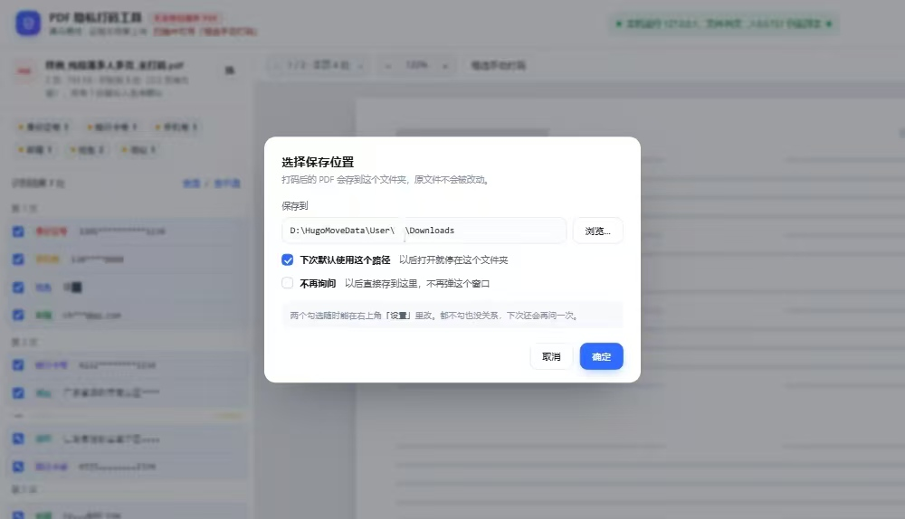
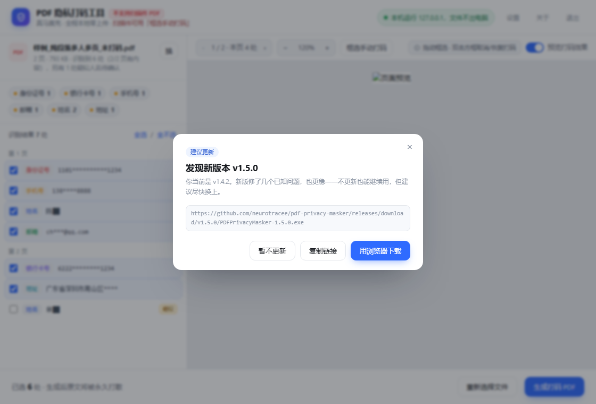
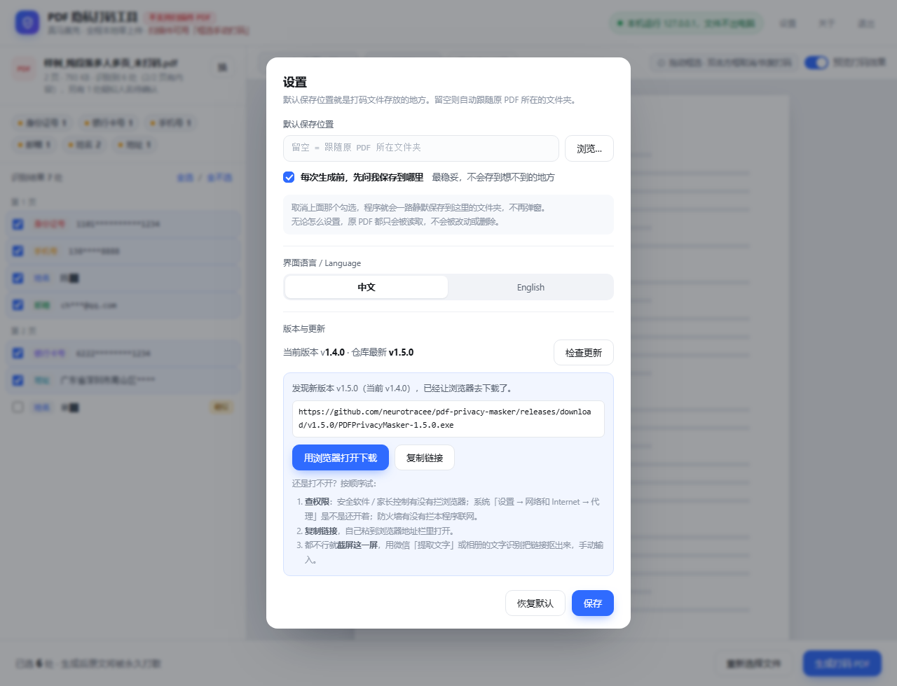

# Windows 端使用说明

> 适用于 Windows 版单文件 exe（文件名形如 `PDFPrivacyMasker-<版本号>.exe`，Windows 10 / 11，64 位，免安装）。
> 安卓端请看 [02-使用说明-安卓.md](02-使用说明-安卓.md)；想先知道这版改了什么，看 [CHANGELOG.md](../CHANGELOG.md)。

---

## 1. 开始用

1. 双击下载到的 `PDFPrivacyMasker-<版本号>.exe`。
2. 界面会自己在默认浏览器里打开，地址是 `127.0.0.1` 的一个随机端口——**只有本机能访问**。
3. 把 PDF 拖进虚线框，或点「选择 PDF 文件」。
4. 等 1–2 秒，识别到的敏感信息会逐条列在左边，右边是页面预览。

首次启动慢 1–2 秒是正常的（单文件程序要先自解压到临时目录）。
如果 Windows 弹出「已保护你的电脑」，点「更多信息 → 仍要运行」——程序没有购买数字签名证书，不影响任何功能。

**退出**：点右上角「退出」，或直接关掉页面（无操作 30 分钟后自动退出）。

---

## 2. 处理页怎么用

### 2.1 逐条确认

- 每条识别结果前面有勾选框，点一下取消 / 恢复。
- 点某一条，右边自动跳到那一页并高亮对应位置。
- 橙色标着「疑似」的条目，是程序"看着像人名、但证据不够"的候选，**默认不打勾**；看一眼确实是人名，就勾上。
- 顶部会显示「X/Y 页有内容」，翻页处显示「本页 N 处」。

### 2.2 手动框选

自动识别认不出来的（扫描件、图片里的字、程序保守放过的），用鼠标补：

1. 点上方工具栏「框选手动打码」。
2. 在页面上**按住鼠标拖一个框**，松手即成打码区域。
3. 手动画的框是蓝色虚线，和自动识别的红框一样参与最终打码，效果一样不可还原。

### 2.3 双击取消 / 恢复某一处（本版新增）

- 在页面上**双击任意一个方框**（红框、蓝虚线框都行），该处打码取消，框变灰。
- 再双击一次，恢复打码。
- 双击后会弹一条提示，写明取消了哪一处、内容是什么。
- 命中判定在框外留了 6px 余量，小字框也点得中。

处理页顶部有一条浅底提示条常驻：`拖动框选 · 双击方框取消/恢复打码`。
窗口宽度小于 1040px 时它会自动隐藏，避免挤坏工具栏——功能不受影响，鼠标悬停原位置仍有完整说明。

### 2.4 预览打码效果

工具栏右侧有「预览打码效果」勾选，默认勾上。取消勾选可以只看原页面，用来核对框有没有偏移。

---

## 3. 打码后的文件存哪

第一次点「生成打码 PDF」时，程序会先问你要存到哪个文件夹：

1. 点「浏览…」选一个目录（也可以直接粘贴路径），点「确定」。
2. 窗口里有两个勾选，按需要勾：
   - **下次默认使用这个路径**：以后打开就停在这个文件夹
   - **不再询问**：以后直接存到这里，不再弹这个窗口

想改回来：点右上角「设置」→「默认保存位置」，用勾选的方式改，不用记任何命令：

- **默认保存位置**：选或填一个文件夹；留空则跟随原 PDF 所在的位置
- **每次生成前，先问我保存到哪里**：勾上就每次都问（最稳妥）

其他规则：

- 指定的文件夹不存在时程序会自动创建，不报错。
- 原 PDF **只读不写**，不会被修改或覆盖；同名文件自动加序号。
- 忘了存到哪：生成完成的窗口里直接有「打开所在文件夹」。
- 什么都没设置时：拖入的文件存到「下载」文件夹，双击打开的 PDF 存到原文件旁边。
- 生成后可以直接「打开 PDF」「打开所在文件夹」，或「另存到别处…」再存一份。

---

## 4. 检查更新（v1.4.2 起自动检查）

**打开程序时会自动查一次**，不用你点。查到有新版本，会直接用默认浏览器打开发布页，同时弹一个窗口把「用浏览器下载」「复制链接」两条路都摆出来。

自动检查的退路都留好了，任何一种都不会把你卡在门外：

| 情况 | 程序会做什么 |
| --- | --- |
| 已是最新 | 什么都不显示，直接进主程序 |
| 断网 / 网络被拦 / 超时 | 静默跳过，不弹窗、不报错，照样打码（离线可用不受影响） |
| 网络很慢（超过 1.2 秒还没回来） | 弹「正在检查更新」，右上角有 ×，点一下就跳过 |
| 超过 12 秒还没结果 | 弹「检查更新没有回应」，点「进入主程序」直接走 |
| 发现新版本 | 自动打开浏览器；窗口里还有「用浏览器下载」「复制链接」「暂不更新」 |
| 作者标了强烈建议更新 | 徽标变橙红、话更重，但照样能关（见下） |

### 4.1 建议更新和强烈建议更新的区别

更新级别写在发布说明里，程序读的是那一行标记。**两档都只是建议，都能关掉**，区别只在提醒的语气：

- **建议更新**（默认）：蓝色徽标，窗口上有「暂不更新」，关掉就能正常用，只是会提醒你新版本更稳。
- **强烈建议更新**：橙红色徽标，标题是「强烈建议更新到 vX」——通常是这一版修了会天天碰到的问题。窗口依然有「暂不更新」和右上角的 ×。

### 4.1.1 点「暂不更新」之后

第一次点「暂不更新」「以后再说」或右上角的 ×，会先弹一次挽留（「再看一眼，好吗？」），把不更新的影响说清楚。看完再点「我还是要用旧版」就真的放行，直接进主程序，不会再拦你——挽留只有这一次。

两个平台读的是同一行，所以你不需要为 Windows 和安卓分别写。

### 4.2 手动检查

右上角「设置」→「版本与更新」→「检查更新」，逻辑和上面完全一样，只是由你来点。自动检查出过问题、或者你想立刻确认版本时用它。

| 情况 | 程序会做什么 |
| --- | --- |
| 已是最新 | 显示当前版本与「已是最新版本」 |
| 有新版本 | 直接用默认浏览器打开下载页，同时把链接明文显示出来，给「复制链接」按钮 |
| 打不开浏览器 / 网络被拦 | 显示链接 + 复制按钮 + 三步排查清单 + 截屏 OCR 兜底 |

排查清单的顺序就是最可能的原因：

1. 安全软件 / 家长控制有没有拦浏览器；
2. 系统「设置 → 网络和 Internet → 代理」是不是开着；
3. 防火墙有没有拦本程序联网。

实在都排不掉：点「复制链接」自己粘到浏览器，或者直接截屏这一屏，用微信「提取文字」把链接抠出来手动输。

**隐私**：整个过程只发一个查版本号的请求，不传文件、不传任何个人信息。断网时它连提示都不会有。

手动检查时的兜底界面（链接、复制按钮、三步排查清单）：

---

## 5. 界面语言

同一个「设置」面板里，「界面语言 / Language」中英文一键切换：

- 立即生效，不用重启；
- 选择会记住，下次打开还是这个语言；
- 正文段落、文件摘要、识别类型标签、状态栏提示都会一起切换（本版补齐）。

---

## 6. 它到底做了什么

1. 读出 PDF 的文字层与版面坐标；
2. 按规则找出敏感信息（详见 [03-识别规则与已知限制.md](03-识别规则与已知限制.md)）；
3. 把对应区域按像素重采样成小块，字形信息在采样时被丢弃，再向区域均色压平并叠加随机扰动；
4. **同时把这段的文本层删掉**——复制粘贴、搜索、提取文字都拿不到原文；
5. 另存为一个新的纯图片 PDF，文档属性（作者等）清空。

所以打码后无法还原，也不能用工具"反马赛克"。

---

## 7. 隐私与文件位置

- 程序只监听 `127.0.0.1`，不对外暴露端口，不上传任何文件。
- 处理全程在本机内存与临时目录完成，退出时清理临时文件。
- 唯一会写文件的地方：你指定的输出路径。
- 偏好文件：`%APPDATA%\PDF隐私打码工具\settings.json`，里面只有「默认保存路径」「两个开关」「界面语言」，不含文档内容、不含个人信息，删掉即恢复默认。
- 程序本体可以整个文件夹拷到别处或 U 盘直接用，换电脑也不需要安装。挪动位置后，桌面快捷方式要右键 → 属性 → 重新指向新的 exe。

---

## 8. 已知限制

- **不支持扫描件 PDF**：整页是图片、没有文字层，自动识别无从下手——界面左上角有红字常驻提示。这类文件请用「框选手动打码」。
- 加密 / 带密码的 PDF 需要先解除密码。
- 以「镇 / 苑 / 道 / 路 / 街 / 村 / 庄」结尾的姓名会保守放过，请手动框选。
- 被换行拆成两半的姓名、号码可能漏掉。
- 纯以中文数字写的号码（「一三八零零…」）不识别。

完整清单与原因见 [03-识别规则与已知限制.md](03-识别规则与已知限制.md)。

---

## 9. 关于窗：署名与赞赏码

点右上角「关于」看到的窗口里，除了署名、许可和原项目地址，最下面有一个赞赏码。

**想存下来**：二维码下面有一个「保存赞赏码」按钮，点一下就把图片存成 `PDFPrivacyMasker-赞赏码.png`（跟着浏览器/系统的下载目录走）。英文界面下按钮是「Save the tip QR」，文件名变成 `PDFPrivacyMasker-thanks-qr.png`。

以前这里只写了一行小字「右键可保存图片」——能用，但几乎没人会想到去右键，所以 v1.4.1 换成了按钮。

**不想花钱怎么支持**：卡片上有一个「去点 Star」按钮，点一下打开仓库，点一颗 Star 就够了——不用注册付费，也不影响你继续用。打不开浏览器时会自动把仓库地址复制到剪贴板。

**国内用户**：二维码上方那行写着「微信扫码，请我喝杯奶茶（金额随意）」，完全自愿。
