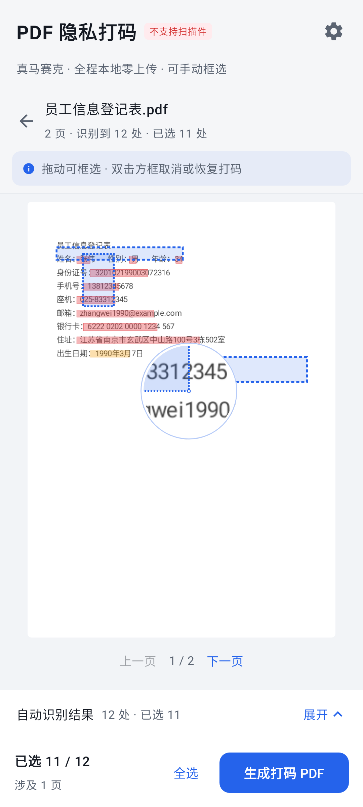
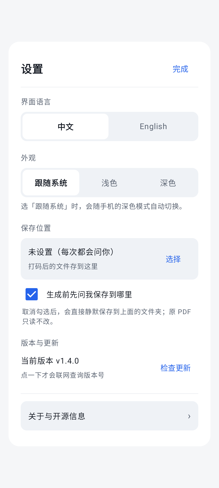

# 安卓端使用说明

> 适用于安卓版 arm64 apk（文件名形如 `PDFPrivacyMasker-<版本号>-arm64.apk`，Android 8.0 及以上）。
> Windows 端请看 [01-使用说明-Windows.md](01-使用说明-Windows.md)；这版改了什么看 [CHANGELOG.md](../CHANGELOG.md)。

---

## 1. 安装

1. 把 `PDFPrivacyMasker-<版本号>-arm64.apk` 传到手机上，点开安装。
2. 系统可能提示「未知来源应用」——允许当前文件管理器或浏览器安装即可。
3. 装好后桌面出现「PDF 隐私打码」图标。

> **OPPO / vivo / 小米 / 荣耀 会先弹一个「未验证应用提醒」。** 这是 2026 年 11 月起四家联合上线的开发者实名校验（ADV），核对开发者实名、包名、签名三项是否在平台登记过。本项目从 Gitee / GitHub 直接分发、未在国内商店上架，所以必定显示「未验证」。
>
> 处理：**勾选「已知悉应用风险」→ 点「仍然安装」**（按钮是灰的通常就是因为没勾）；个别机型再输一次锁屏密码。国内这套只提醒、不拦截，也没有海外 Google 流程的 24 小时等待，每次装新版本会再提示一次。详见 [常见问题](04-常见问题.md) 第一节。

只支持 **arm64-v8a**（近几年的手机基本都是）。权限两个，都只服务更新：`INTERNET`（读一次公开的版本号、下载安装包本身）和「安装应用」（把核对过的安装包交给系统安装器，系统还会再问你一次，你不点就不会装）。

---

## 2. 首页：选文件

- 中间是一张大卡片，点它打开系统文件选择器，挑一个 PDF。
- 也可以从微信 / QQ / 文件管理器里选「用其他应用打开」直接送进本程序。
- 选过以后程序只拿到**这一个文件**的临时读权限，不会扫描你的相册或存储。

---

## 3. 处理页：三个区域

从上到下：

1. **顶栏**：返回（换一个文件）、文件名、`X 页 · 识别到 N 处 · 已选 M 处`。
2. **提示条**：`拖动可框选 · 双击方框取消或恢复打码`。
3. **预览区**：占满内容区（约 80% 屏高），底下有「上一页 / 下一页」。
4. **底部折叠条**：点一下从下升起「自动识别结果」浮层面板，再点收起。
5. **底部按钮**：`生成打码 PDF`，始终可见。

单栏手机上预览优先，勾选时再展开面板；平板或横屏自动变双栏（左列表右预览）。折叠屏会按铰链宽度留白，不会把内容压在折痕上。

---

## 4. 三件事：勾选、框选、双击

### 4.1 逐条确认（点折叠条）

- 每条识别结果前面有勾选框，勾上才会打码。
- 点某一条，预览跳到对应页并高亮。
- 橙色「疑似」条目默认不打勾，确认是人名再勾。
- 面板顶部有「全选 / 全不选」，分组头有「清除全部」，单条右侧有「删除」。
- 收起面板不会重置勾选——这是本版特意修的（以前收起再展开，勾选状态会丢）。

### 4.2 手动框选 + 放大镜（本版新增）

自动识别认不出来的（扫描件里 OCR 没认出的字、文字层 PDF 里嵌的图片、程序保守放过的）：

1. 在预览页上**按住手指拖一个框**，拖动过程会实时画出蓝色虚线框。
2. 同时，手指**右上方会浮出一个圆形放大镜**（96dp，2.8 倍），把手指底下的字放大给你看。
3. **镜子里不只有字，你正在拖的那条虚线框也一起放大画在镜内**，边框和手指位置始终对得上。
4. 靠近屏幕边缘时放大镜自动翻到另一侧，不会被屏幕切掉。
5. 松手即成打码区域，放大镜消失，框留在页面上。

手动画的框和自动识别的框走同一条打码路径，效果一样不可还原。

> 觉得放大镜太大或倍数不够：改 `android/app/src/main/java/com/neurotracee/pdfmask/ui/WorkScreen.kt` 里 `LoupeOverlay` 的 `d`（直径）和 `zoom`（倍数）两个参数即可。

### 4.3 双击取消 / 恢复某一处（本版新增）

- **双击页面上任意一个方框**：自动识别的红框、手动画的蓝虚线框都算。
- 该处打码取消，框变灰；再双击恢复。
- 底部弹一句「已取消这处打码 / 已恢复这处打码」。
- 框外留了 10dp 的命中余量，小字框也点得中；框重叠时取最上面那一层。

### 4.4 全屏看

点一下预览进入全屏，全屏里同样能拖框、双击、翻页。字太小时用这个。

---

## 5. 生成与保存

1. 点底部 `生成打码 PDF`。
2. 首次会弹「存到哪」：
   - 用系统目录选择器授权一个文件夹（推荐建一个专门的输出目录）；
   - 可勾「下次默认使用这个路径」「不再询问」。
3. 生成完成后显示统计（页数、打码处、命中页），可以直接打开文件或「再弄一份」。

规则：

- 勾了「不再询问」且已授权目录，之后**静默写入**，不再弹窗。
- 重名自动加序号，不覆盖已有文件。
- 原 PDF 只读，不会被修改。
- 想改保存位置：设置 → 保存位置。

---

## 6. 设置面板

| 分区 | 内容 |
| --- | --- |
| 界面语言 | 中文 / English，点一下立即整页切换，不用重启 |
| 外观 | 跟随系统 / 浅色 / 深色 |
| 保存位置 | 选目录、是否每次询问；未设置时显示「未设置（每次都会问你）」 |
| 版本与更新 | 当前版本、检查更新按钮 |
| 关于与开源信息 | 署名、许可、原项目地址、赞赏码 |

### 6.1 检查更新（v1.4.2 起打开就自动查）

**每次打开应用都会自动查一次**，不用你点。查到有新版本会弹一个窗口，里面是**应用内直接下载**：点「立即更新」就在原窗口里下完、校验通过后交给系统安装器，不用经过浏览器，也不用自己去文件夹里找文件；想改用浏览器的话窗口里也留着「用浏览器下载」。

| 情况 | 表现 |
| --- | --- |
| 已是最新 | 什么都不显示 |
| 断网 / 网络被拦 / 超时 | 静默跳过，直接进主程序，不弹任何提示 |
| 网络慢（超过 1.2 秒） | 弹「正在检查更新」，右上角「以后再说」或底部「跳过，先进入」，随时能走 |
| 超过 12 秒没结果 | 弹「检查更新没有回应」，点「进入主程序」 |
| 发现新版本 | 弹更新窗口：应用内下载 + 交给系统安装器；也有「用浏览器下载」「复制链接」「暂不更新」 |
| 作者标了强烈建议更新 | 橙红徽标、话更重，但照样能关：点「暂不更新」会先挽留一次，再点「我还是要用旧版」就放行 |

**改成手动**：设置 → 版本与更新 → 检查方式，选「手动检查」，之后只有你点按钮才会联网（默认是「自动检查（启动时）」）。

**手动检查**：设置 → 版本与更新 → 检查更新。逻辑完全一样，只是由你来点；失败时会给原因、三步排查清单（安全软件是否拦浏览器 / 系统代理 / 是否禁止本应用联网）以及「复制链接」兜底。

**联网只做这一件事**：读一个公开的版本号，不传文件、不传个人信息。断网时自动检查连提示都不会有。

---

## 7. 权限与隐私

| 项 | 说明 |
| --- | --- |
| 网络 | `INTERNET`：只在检查更新时用（读版本号；点更新后下载安装包本身） |
| 安装应用 | `REQUEST_INSTALL_PACKAGES`：把核对过的安装包交给系统安装器。不联网、不读文件 |
| 存储 | **没有**存储权限。选文件走系统文件选择器（SAF），只拿到选中文件的临时读权限；保存由你当场指定目录 |
| 上传 | 不上传任何文件。识别、打码、保存全在本机 |
| 文件残留 | 不写 PDF 缓存副本；导出的是纯图片 PDF，原文字层已抹除。（首次识别扫描件时会把 OCR 模型从安装包解到应用私有目录，约 15 MB，只此一份，随卸载一起清掉） |

---

## 8. 已知限制

- **扫描件的识别质量取决于拍摄条件**：没有文字层的页面会自动用本机 OCR 识别（离线、不上传），模糊、倾斜、反光或字太小时可能认错或漏认，请核对后再生成；漏的地方手动框选补。低配机型上这步会慢一些（每页几秒）。
- 加密 / 带密码的 PDF 需要先解除密码。
- 以「镇 / 苑 / 道 / 路 / 街 / 村 / 庄」结尾的姓名会保守放过。
- 被换行拆成两半的姓名、号码可能漏掉。
- 纯中文数字写的号码不识别。

完整规则见 [03-识别规则与已知限制.md](03-识别规则与已知限制.md)。

---

## 9. 关于窗：署名与赞赏码

设置 →「关于与开源信息」里，最下面是赞赏码。

**想存下来**：**长按二维码**即可。

| 系统 | 长按之后 |
| --- | --- |
| Android 10 及以上 | 手机轻轻一震，图片直接存进相册 `Pictures/PDFPrivacyMasker/`，底部提示「已保存到相册：…」。相册里找不到就去「图片」分类下翻。 |
| Android 8 / 9 | 弹出系统的「保存到…」窗口，由你选文件夹（这两版写相册需要存储权限，程序故意不申请，所以改成你手动选位置）。 |
| 保存失败 | 会明确提示「保存失败，可以截屏后用微信提取文字」，不会静悄悄没反应。 |

连续长按不会存出一堆重复文件——正在保存时再按会被忽略。

> v1.4.0 这里写的是「长按图片可保存」，但图片其实没接长按，按了毫无反应。v1.4.1 修好了。

**不想花钱怎么支持**：上面有一张「星标仓库 = 最好的支持」卡片，点「去点 Star」直接打开仓库；不装浏览器也点得动（打不开时会自动复制地址，粘贴到任意应用里都能开）。安卓端赞赏码下方另有一个「保存赞赏码」按钮，长按也可以。

**国内用户**：卡片下面那行写着「微信扫码，请我喝杯奶茶（金额随意）」，完全自愿，不打赏也一样免费、功能不缺。
